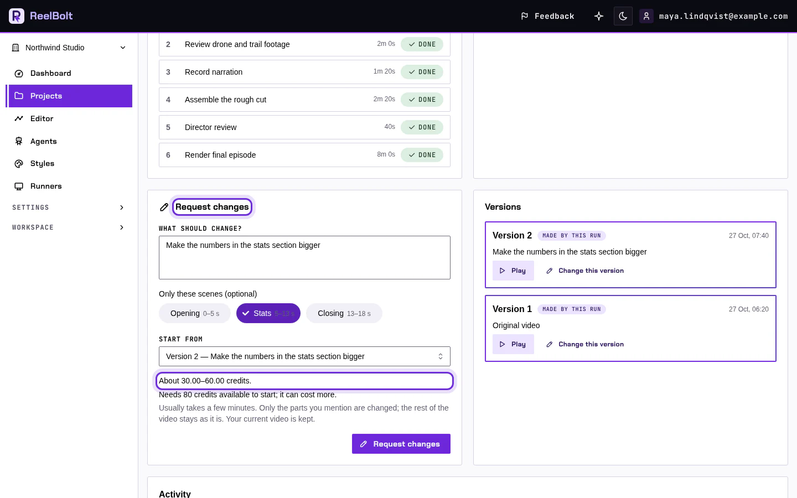

# Ask for changes

You will ask for a change to a finished video. Only the parts you name are changed, and your current video is kept.

## Request a change

1. Open the page of the finished run.
2. Find **Request changes** and write what should change. Be specific about what and where. "Make the numbers in the stats section bigger" works better than "make it better".
3. Optional: under **Only these scenes**, pick the scenes the change is about.
4. Optional: under **Start from**, pick an earlier version.
5. Check the credits shown on the panel, then click **Request changes**.

You should see a new run open. Follow it the same way as before. When it finishes, the new version appears on the **Renders** tab next to the old one.

:::tip If something looks different
- No **Request changes** panel? It shows on finished runs of animated videos only. For other videos, run the app again with a new brief, or use the [editor](./editor-basics.md).
- Part of your animation sits inside a longer edit? The panel lists the later steps that run again and lets you choose what happens to the edit.
:::

Need to change several things at once, like the narration and the graphics? Add each change to a list and send them together; see [Changing several things at once](../workflows/request-changes.md#changing-several-things-at-once).

## Go deeper

- [Request changes to a finished video](../workflows/request-changes.md)
- [What the assistant costs](../account/what-the-assistant-costs.md)

Next: [Editor basics](./editor-basics.md).
