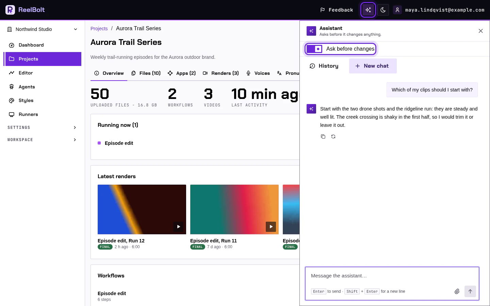
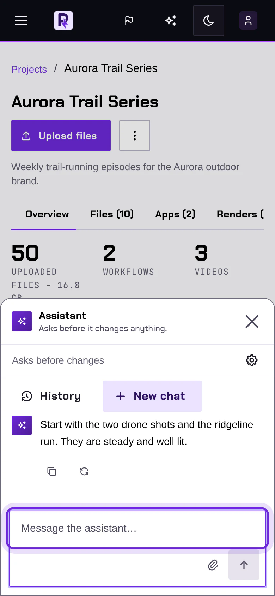
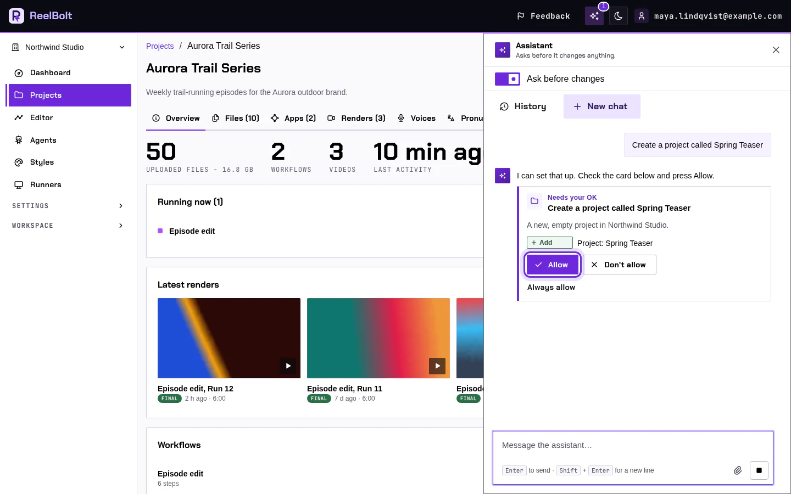

# Assistant basics

You will ask the assistant a question and approve a change it suggests.

## Ask a question

1. Click the sparkle button in the top bar. It is called **Assistant**. The chat opens on the right.
2. Type in the message box, for example "Why did my last run fail?" or "What should I upload?".
3. Send the message and read the answer.

The assistant knows which page you are on. On a project page, "this project" means that project.

On a phone, the chat slides up from the bottom of the screen.

## Let it make a change

1. Ask for something, for example "Create a project called Spring Teaser".
2. A card in the chat says what the assistant is about to do.
3. Click **Allow** to go ahead.

Nothing changes until you click **Allow**. The **Ask before changes** switch at the top of the panel is on by default. Leave it on until you are used to the assistant. On a phone, the panel shows this setting as **Asks before changes**.

:::tip If something looks different
- Several pages have shortcut buttons that open the assistant with a ready question, such as **Why did my last run fail?** on a project's **Overview** tab.
- The assistant uses credits after your plan's monthly allowance. See [What the assistant costs](../account/what-the-assistant-costs.md).
:::

## Go deeper

- [The assistant](../assistant/index.md)
- [What the assistant costs](../account/what-the-assistant-costs.md)

Next: [Pictures and thumbnails](./pictures-and-thumbnails.md).
