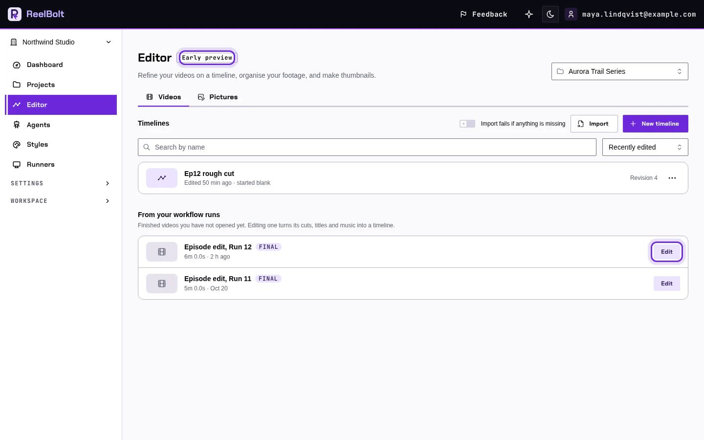
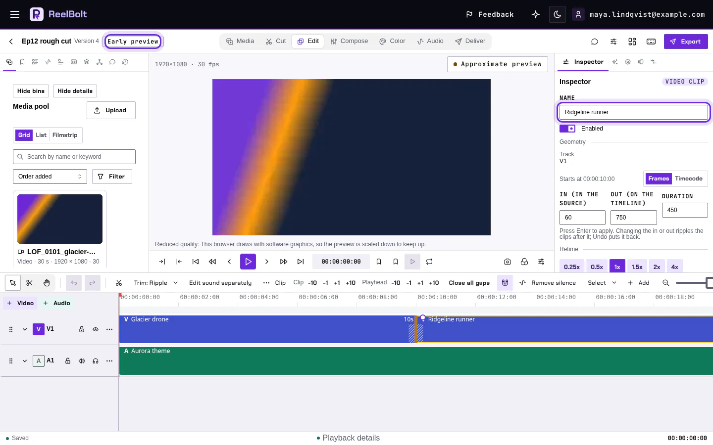

# Editor basics

You will open a video as a timeline, the tracks of clips laid out in time, and change it by hand.

:::note Early preview
The editor is an **Early preview**. It is still being finished. Your work is saved, but some tools may change. Click or tap the **Early preview** label on any editor page to read more.
:::

## Open a timeline

1. Click **Editor** in the left menu.
2. Choose your project with the project picker at the top right.
3. On the **Videos** tab, find your video under **From your workflow runs** and click **Edit**. Or click **New timeline** to start a blank one.

The timeline opens. Opening the same video again brings you back to the timeline you already made.

## Play and make a small change

1. Press the play button, or the space bar, to watch the edit.
2. Click a clip to select it. Drag it to move it.
3. Use the undo button if you change your mind. Your changes are saved as you go.

The editor changes the edit, not the finished video file. To get a new video, render it from the editor's export screen.

:::tip If something looks different
- Your video is not listed? Only finished videos from a run that makes an editable edit appear under **From your workflow runs**. Use **New timeline** instead.
- Some tools look different on a narrow screen. The editor page explains the phone layout.
:::

## Go deeper

- [The timeline editor](../editor/index.md)
- [Saving and recovering](../editor/saving-and-recovering.md)
- [Export your film](../editor/export-your-film.md)

Next: [Assistant basics](./assistant-basics.md).
