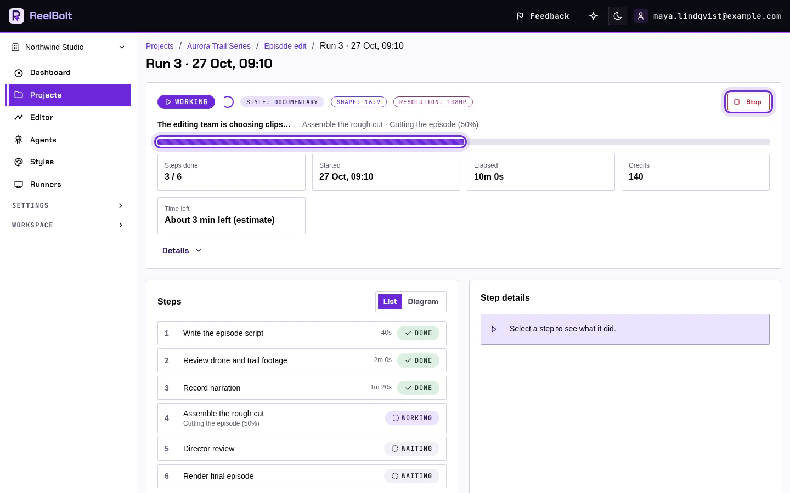
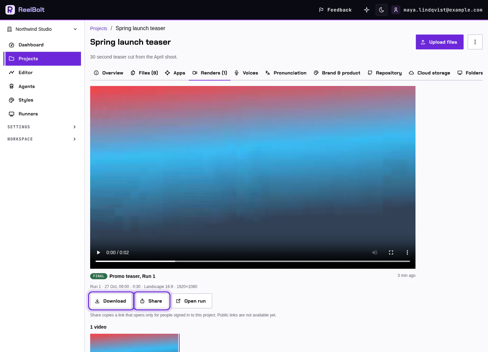

# Follow progress, then download or share

You will watch your run, then get the finished video.

## Watch the run

1. After you start a run, ReelBolt opens its run page.
2. Check the status badge. It reads **Waiting to start**, **Working**, **Finished**, **Failed** or **Stopped**.
3. Read the line above the progress bar. It says in plain words what is happening now, for example "Writing the narration".
4. Open **Activity** to see what has happened so far, newest first.

A run can take from a few minutes to much longer. You can leave the page. The run carries on, and the dashboard shows it under runs in progress. To cancel it, click **Stop**.

## Get the video

1. When the status is **Finished**, open your project and go to the **Renders** tab.
2. Click the newest render marked **Final** to play it.
3. Click **Download** to save the file.
4. Click **Share** to copy a link or open your device's share sheet.

A new video can briefly show **Checking your video**. It appears by itself when the check is done, so you do not need to reload the page.

A yellow box at the top of the run page or under the player means something did not turn out as asked. Read it before you share the video.

:::tip If something looks different
- The share link only opens for people who are signed in to your project, so it is not for sending to a client. Use **Download** for that.
- The run shows **Failed**? Open the assistant and ask "Why did my last run fail?", or read [Troubleshooting](../troubleshooting.md).
:::

## Go deeper

- [Running workflows and finding the results](../workflows/execution-and-outputs.md)
- [Getting started](../getting-started.md#watching-a-reelbolt-workflow-run)
- [Troubleshooting](../troubleshooting.md)

Next: [Ask for changes](./ask-for-changes.md).
