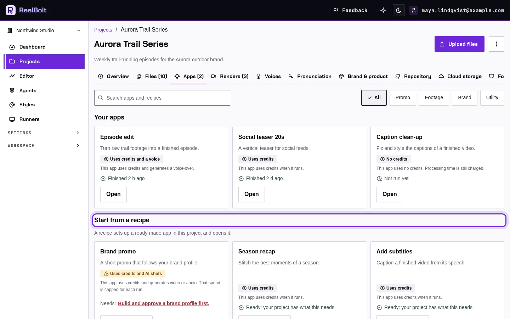
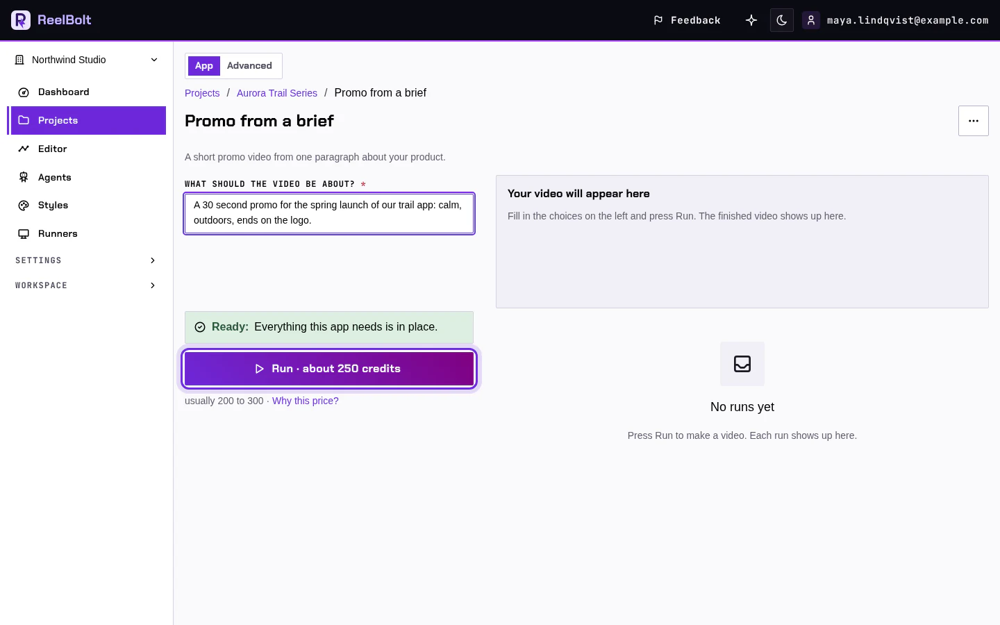

# Pick an app and run it

You will choose a ready-made app for your project and start it. The app makes the video.

## Choose an app

1. Open your project and go to its **Apps** tab.
2. Under **Start from a recipe**, pick the app that matches what you want to make. A recipe sets up a ready-made app in your project and opens it.
3. If you already set one up, it is listed under **Your apps**. Click **Open**.

Every new project already has a starter app that makes a promo video from your code.

## Check and run

1. Read what the app asks for. Fill in the boxes you see, for example what the video is about, how long it should be and the format.
2. Look for the green **Ready** line, which says everything the app needs is in place. If a line says something is missing, fix that first, for example by uploading a file.
3. Check the price on the **Run** button. This is the number of credits the run is expected to use.
4. Click **Run**. If a confirmation box opens, read it, write your brief if it asks for one, and click **Start run**.

You should see the run start and a message that your video is being made.

:::tip If something looks different
- Your project has a **Workflows** tab instead of **Apps**? Open your workflow there and click **Run**. The steps after that are the same.
- **Run** is greyed out? The line below it says why and what fixes it, such as an unconfirmed email or too few credits.
- Not sure which app to choose? Read [Choose a recipe](../recipes/choose-a-recipe.md).
:::

## Go deeper

- [Choose a recipe](../recipes/choose-a-recipe.md)
- [Reading the estimate](../account/reading-the-estimate.md)
- [Run settings](../recipes/run-settings.md)

Next: [Follow progress, then download or share](./follow-progress-and-share.md).
