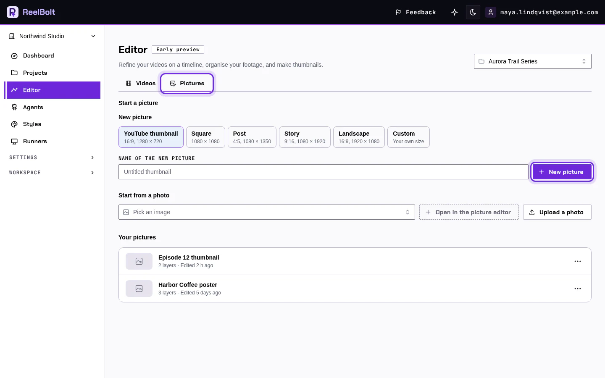
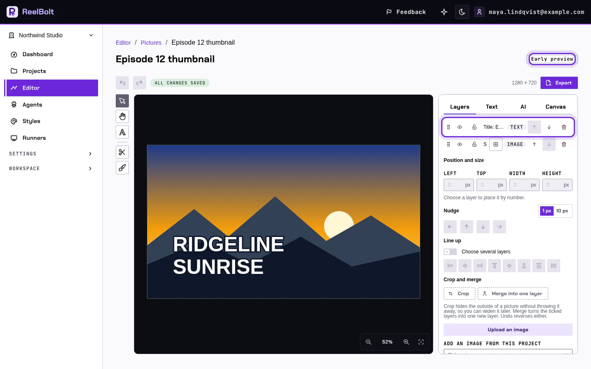

# Pictures and thumbnails

You will start a picture in the picture editor and export it. Your original picture is never changed. Every edit is a layer on top.

:::note Early preview
The picture editor is part of the editor's **Early preview**. Your work is saved, but some tools may change.
:::

## Start a picture

1. Click **Editor** in the left menu and choose the **Pictures** tab.
2. Pick a shape under **New picture**, for example Landscape 16:9. Give it a name and click **New picture**.
3. To start from a photo instead, pick one of your images and click **Open in the picture editor**, or click **Upload a photo**.

## Add text and export

1. In the editor, add a text layer and type your title.
2. Move and resize it on the canvas.
3. Open the export options and choose a format, such as PNG or JPEG.

The AI tools, such as cutting out a subject, cost credits each time you use one. The price shows before you run it.

:::tip If something looks different
- Names of tools and buttons can change while the editor is in Early preview. The [full guide](../editor/thumbnails.md) shows the current ones.
- On a phone, the editor has its own layout. See the "On a phone" section of the full guide.
:::

## Go deeper

- [Make a thumbnail](../editor/thumbnails.md)
- [Plans and credits](../account/plans-and-credits.md)

Next: [Plan, credits and billing](./plan-credits-and-billing.md).
