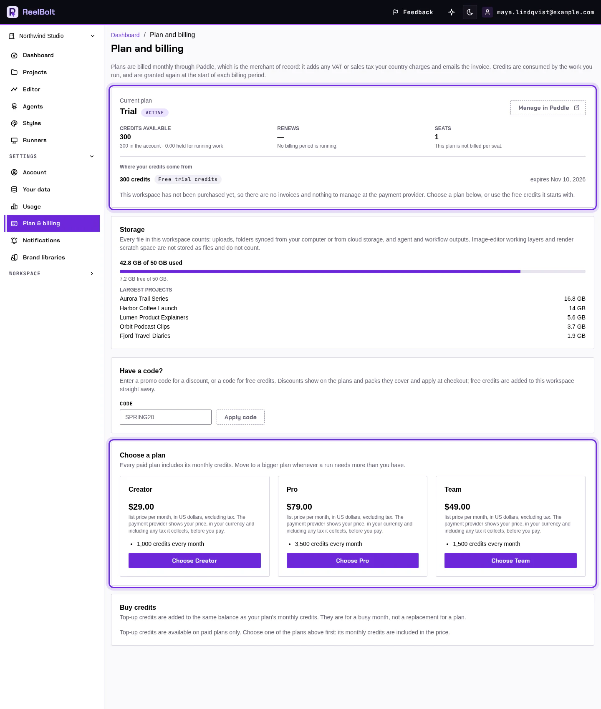
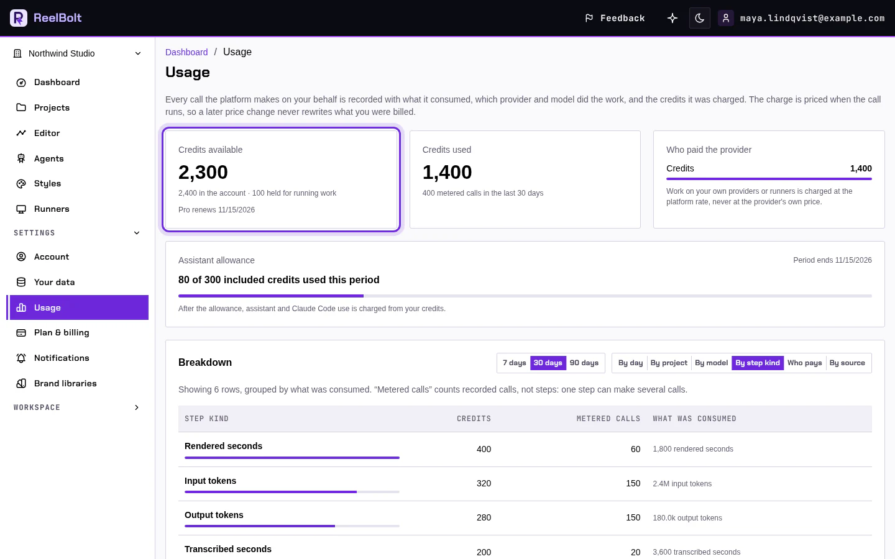

# Plan, credits and billing

You will find your plan and your credits, and see what work costs.

## See your plan and credits

1. Open **Settings** in the left menu and choose **Plan & billing**.
2. Read **Current plan** to see the plan your workspace is on.
3. Open **Usage** in the same section to see your balance and what you have used.

A credit is one unit of spend. Videos, assistant answers beyond your monthly allowance, and picture AI tools use credits. Before you start a run, its expected credits show on the **Run** button.

## Change your plan

Only the workspace Owner and members with the Billing role can buy or change a plan. Everyone else sees the page read-only.

1. On **Plan & billing**, click **Choose** on a plan under **Choose a plan**.
2. Finish the checkout with the payment provider. Credits are added after the provider confirms your payment.

:::tip If something looks different
- Buttons are missing? You can see the page but not change it. Ask the workspace Owner.
- Credits not added yet? Wait a few minutes for the payment to be confirmed, then reload the page.
:::

## Go deeper

- [Plans and credits](../account/plans-and-credits.md)
- [Managing your plan](../account/managing-your-plan.md)
- [Reading the estimate](../account/reading-the-estimate.md)

Next: [Connect a runner](./connect-a-runner.md).
