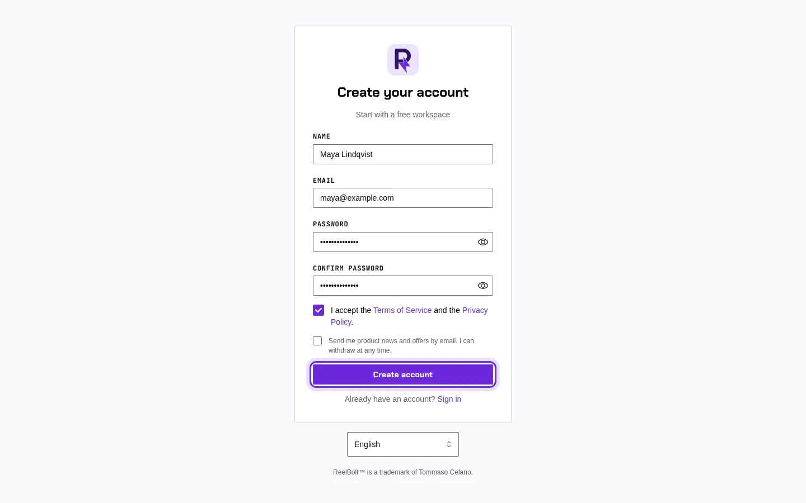
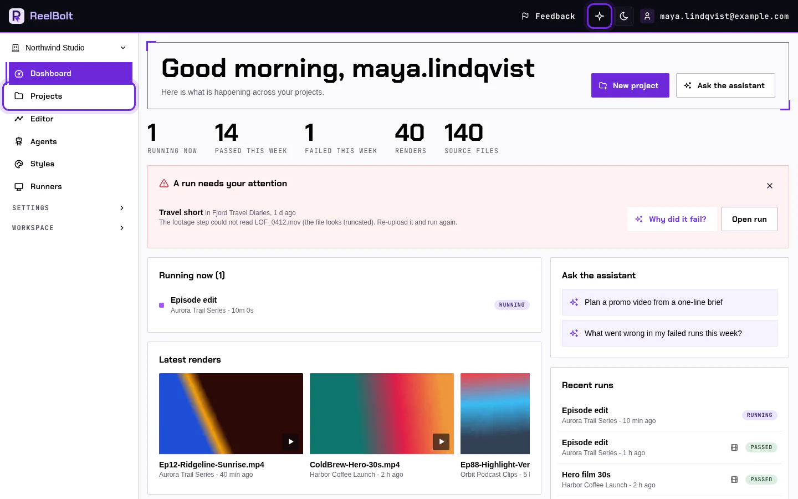
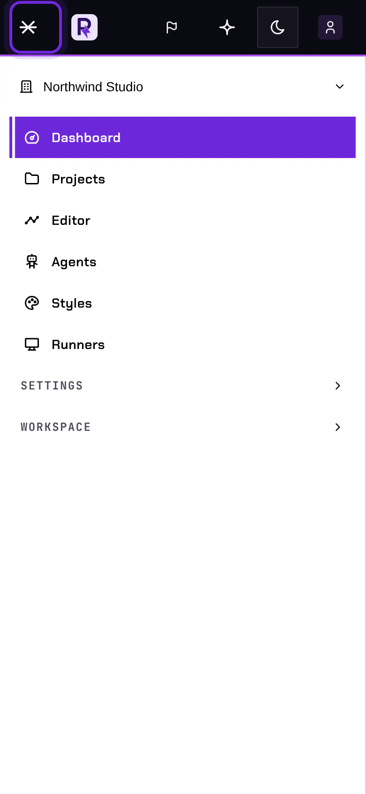

# Sign up and take a first look

You will create your account, sign in and find the main places in ReelBolt.

## Create your account and sign in

1. Open the sign-up page.
2. Enter your **Name**, **Email** and a **Password** (at least 10 characters), then type the password again in **Confirm password**.
3. Tick the box to accept the Terms of Service and the Privacy Policy. The product-news box below it is optional. Then click **Create account**.
4. Open the confirmation link in the email ReelBolt sends you.
5. Sign in with your email and password.

You should see the dashboard. Until you confirm your email, a yellow **Confirm your email address** bar stays at the top and runs that cost money are switched off. Use **Resend the email** on that bar if the message did not arrive.

:::tip If something looks different
- There is no sign-up page? Your ReelBolt may be run by an administrator who creates accounts. Ask them for your email and a temporary password, sign in, then choose a new password when asked.
- No email? Check your spam folder, then use **Resend the email**.
:::

## Find your way around

The menu on the left has the places you use every day:

- **Dashboard**: recent activity and runs in progress.
- **Projects**: one project for each video you make.
- **Editor**: open a video as a timeline, or work on a picture (Early preview).
- **Agents**, **Styles** and **Runners**: the AI workers, the editing looks, and any computers you have connected.

The sparkle button in the top bar opens the **assistant**. **Settings** at the bottom of the menu holds your account, your usage and your plan.

On a phone, the menu is behind the menu button in the top bar. Tap it, pick a place, and the menu closes.

:::tip If something looks different
Some entries only show for some people. **Workspace** appears for workspace owners and admins, and **Platform** only for administrators of the whole installation.
:::

## Go deeper

- [Getting started](../getting-started.md)
- [Workspaces and teams](../workspaces.md)
- [Concepts](../concepts.md)

Next: [Create a project and upload files](./create-a-project-and-upload.md).
