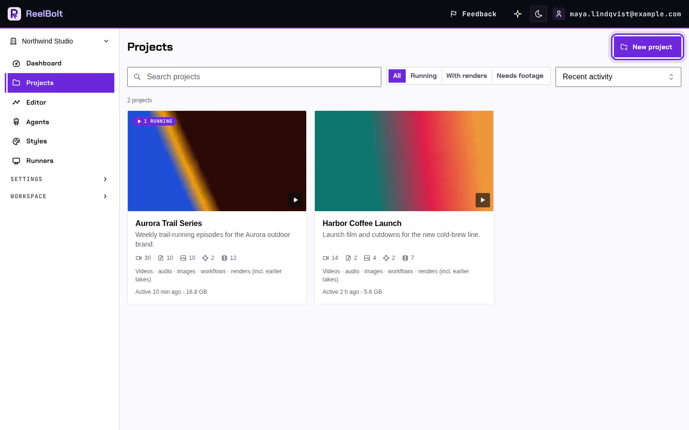
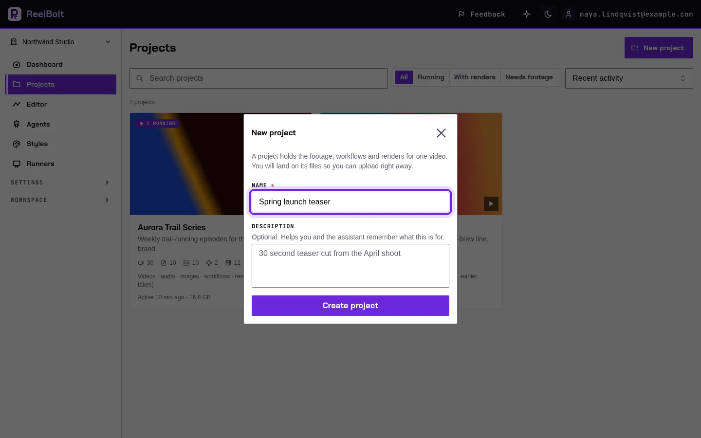
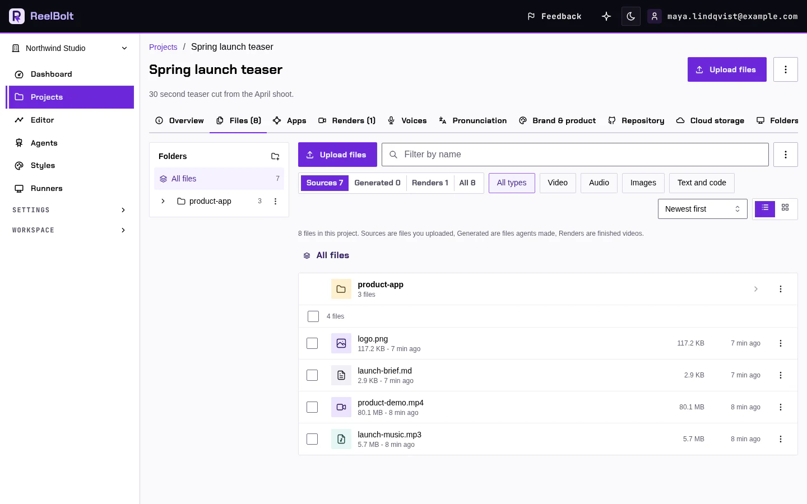

# Create a project and upload files

You will make a project, which is the folder for one video, and add your material to it.

## Create the project

1. Open **Projects** in the left menu.
2. Click **New project**.
3. Type a **Name**, for example "Spring launch teaser". A **Description** is optional.
4. Click **Create project**.

The new project opens on its **Files** tab.

## Upload your files

1. Click **Upload files** at the top of the project page (or use **Upload** on the **Files** tab).
2. Choose files, or choose a folder. A folder keeps its structure.
3. Wait for the uploads to finish.

You can also drag files or folders anywhere onto the project page.

Check your upload. Uploaded files are listed under **Sources**. Click a file to preview it.

You can upload your app's code as a `.zip`. ReelBolt unpacks it into a folder, and skips `node_modules` and build output. See [Give ReelBolt your code](../projects/give-your-code.md).

Which files to upload depends on the video. For a promo of your product, upload its source code. For an edit, upload your footage and any music.

:::tip If something looks different
- A file name is refused? A name cannot be empty, contain `/` or `\`, or match another file in the same folder. ReelBolt tells you which.
- Not sure what to upload? Open the assistant and use **What should I upload?** on an empty **Files** tab.
:::

## Go deeper

- [Uploading files](../getting-started.md#uploading-files-to-a-reelbolt-project)
- [Give ReelBolt your code](../projects/give-your-code.md)
- [Syncing files from GitHub](../projects/github-repository.md)
- [Concepts](../concepts.md)

Next: [Pick an app and run it](./pick-an-app-and-run.md).
