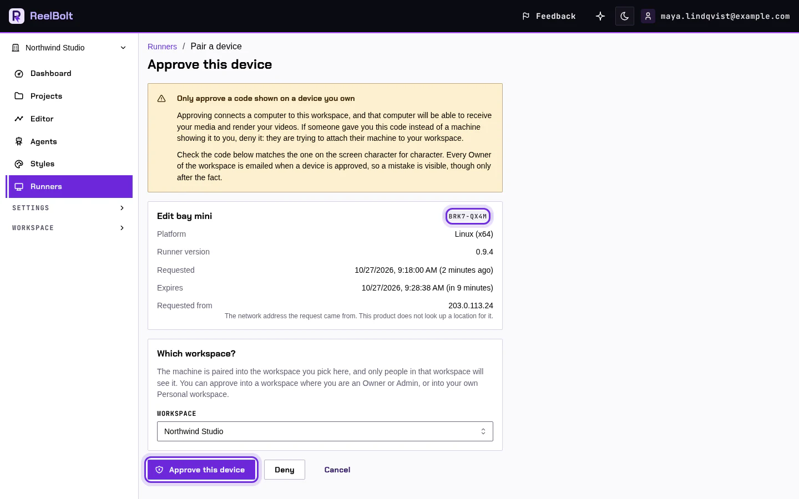
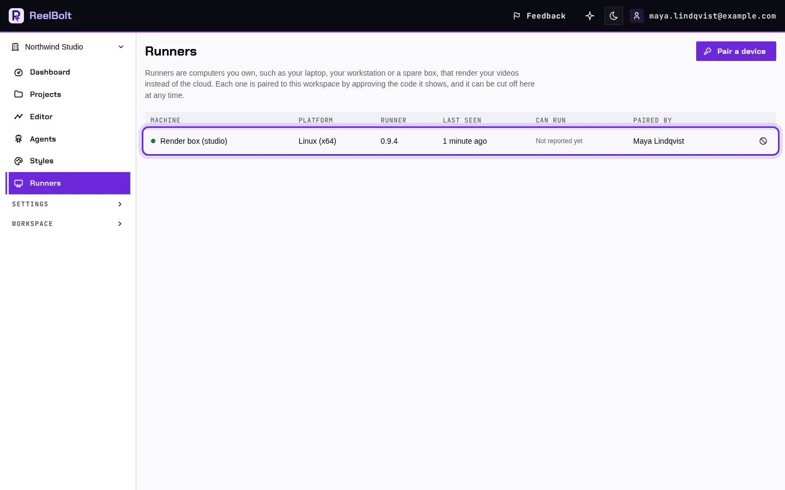

# Connect a runner

This guide is optional and is not part of your first video. You will pair a computer you own so it does the heavy video work instead of the cloud.

## Pair your computer

1. Install the ReelBolt Runner on your Windows or Linux computer. The [install pages](../runner/index.md) show how.
2. Start the Runner. It shows a short code and opens a ReelBolt page in your browser.
3. On the **Approve this device** page, check that the code matches the one on your computer.
4. Choose the workspace to pair the computer into.
5. Click **Approve this device**.

The computer now appears under **Runners** in the left menu.

Work done on your computer uses no ReelBolt credits. The AI thinking, billing and storage stay on ReelBolt.

:::tip If something looks different
- The code expired? Ask the Runner for a new one.
- You cannot pick the workspace? You need to be an Owner or Admin of it.
:::

## Go deeper

- [ReelBolt Runner](../runner/index.md)
- [Pair the Runner](../runner/pairing.md)
- [Desktop runner](../account/desktop-runner.md)
