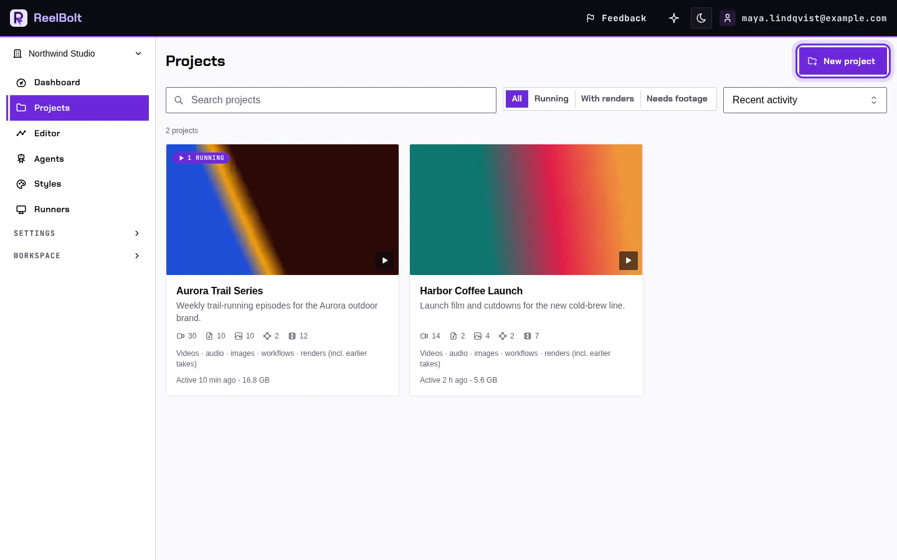
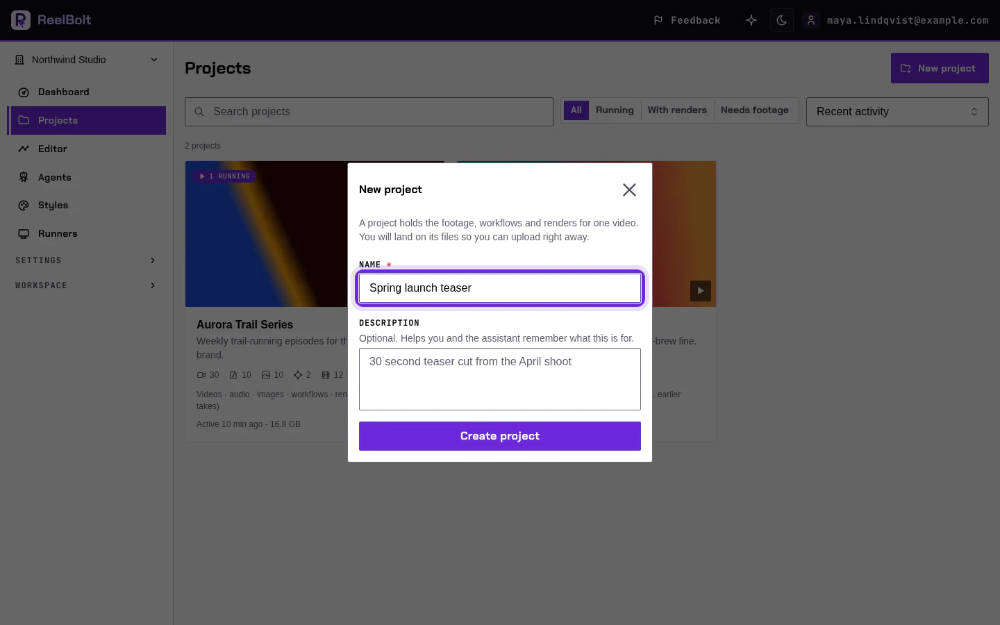
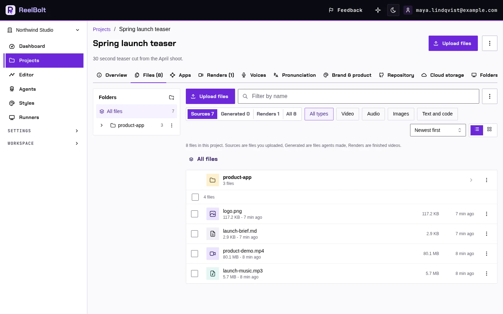

# Create a project and upload files

You will make a project, which is the folder for one video, and add your material to it.

## Create the project

If you answered the two questions after signing up, you already have a project called **My first video**. Open it from **Projects** and go straight to [Upload your files](#upload-your-files). To make another project:

1. Open **Projects** in the left menu.
2. Click **New project**.
3. Type a **Name**, for example "Spring launch teaser". A **Description** is optional.
4. Under **What is this video made from?**, choose **Clips I already shot** or **An app or website I built**. This decides the first app the project gets. You can add other apps later.
5. Click **Create project**.

The new project opens on its **Files** tab.

## Upload your files

1. Click **Upload files** at the top of the project page (or use **Upload** on the **Files** tab).
2. Choose files, or choose a folder. A folder keeps its structure.
3. Wait for the uploads to finish.

You can also drag files or folders anywhere onto the project page.

Check your upload. Uploaded files are listed under **Sources**. Click a file to preview it.

You can upload your app's code as a `.zip`. ReelBolt unpacks it into a folder, and skips `node_modules` and build output. See [Give ReelBolt your code](../projects/give-your-code.md).

**A zip over 64 MB is not unpacked.** ReelBolt stores it but cannot read it. If you choose a bigger zip, ReelBolt warns you before it uploads, and you can cancel or upload it anyway. Send your code another way instead: [connect your GitHub repository](../projects/github-repository.md), make a smaller zip without build output, dependencies and media, or upload the key folders and files directly.

Which files to upload depends on the video. For an edit, upload your clips and any music. Several different shots make a better edit than one long take. For a promo of an app or website you built, upload its source code.

**Analyse videos when they are uploaded.** If you upload videos for editing, you can have ReelBolt look at each new video in the background as soon as it is uploaded. It finds the scenes, the pauses and the moments where something happens, so workflows that need them start faster. Open the menu at the top of the project page, choose **Edit name and description**, switch on **Analyse videos when they are uploaded** and save. It is off by default, it applies to videos you upload from then on, and it uses no credits. Your results are the same with it on or off; only the wait changes.

:::tip If something looks different
- A file name is refused? A name cannot be empty, contain `/` or `\`, or match another file in the same folder. ReelBolt tells you which.
- Not sure what to upload? Open the assistant and use **What should I upload?** on an empty **Files** tab.
:::

## Go deeper

- [Uploading files](../getting-started.md#uploading-files-to-a-reelbolt-project)
- [Give ReelBolt your code](../projects/give-your-code.md)
- [Syncing files from GitHub](../projects/github-repository.md)
- [Concepts](../concepts.md)

Next: [Pick an app and run it](./pick-an-app-and-run.md).
