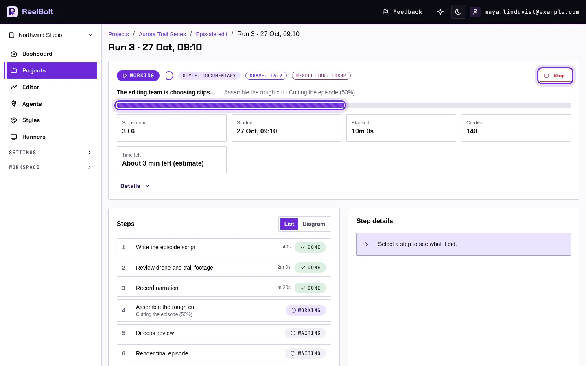
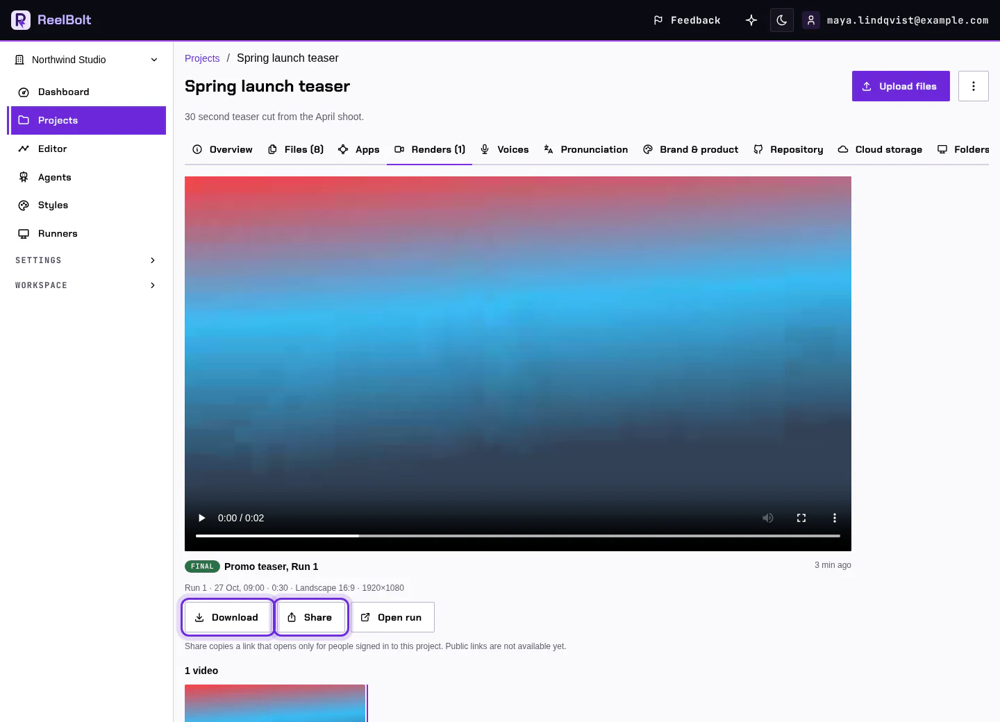

# Follow progress, then download or share

You will watch your run, then get the finished video.

## Watch the run

1. After you start a run, ReelBolt opens its run page.
2. Check the status badge. It reads **Waiting to start**, **Working**, **Finished**, **Failed** or **Stopped**.
3. Read the line above the progress bar. It says in plain words what is happening now, for example "Writing the narration".
4. Open **Activity** to see what has happened so far, newest first.

A run can take from a few minutes to much longer. You can leave the page. The run carries on, and the dashboard shows it under runs in progress. To cancel it, click **Stop**.

## Get the video

1. When the status is **Finished**, open your project and go to the **Videos** tab.
2. Click the newest video marked **Final** to play it.
3. Click **Download** to save the file.
4. Click **Share** to copy a link or open your device's share sheet.

A new video can briefly show **Checking your video**. It appears by itself when the check is done, so you do not need to reload the page.

A yellow box at the top of the run page or under the player means something did not turn out as asked. Read it before you share the video.

## Your first finished video

The first time one of your videos finishes, the run page shows **Your first video is ready** together with the video. It appears once.

- **Before** and **After** state the facts of this run, when they are known: how many clips you gave it and how long they ran, how long the finished video is, and how many parts of your footage it was cut from. These are the real figures of your run. Nothing is estimated, and a figure that is not known is left out.
- **Download** saves the video.
- **Change something** takes you to where you ask for a change, so you can fix a line or a clip without starting over.
- The third button offers a next step that fits your video, for example **Add subtitles or try another shape**. Adding subtitles opens the subtitles app for a clip you choose. Another shape brings this run's choices back so you can pick a shape and press **Run** again, which is a new run.

Click **Close** to go back to the ordinary result page.

If your first run does not finish, the page says what happened in plain words. If the work failed on our side, the credits held for it are refunded. Your files and choices are still there, so you can run it again.

:::tip If something looks different
- The share link only opens for people who are signed in to your project, so it is not for sending to a client. Use **Download** for that.
- The run shows **Failed**? Open the assistant and ask "Why did my last run fail?", or read [Troubleshooting](../troubleshooting.md).
:::

## Go deeper

- [Running apps and finding the results](../workflows/execution-and-outputs.md)
- [Getting started](../getting-started.md#watching-a-reelbolt-workflow-run)
- [Troubleshooting](../troubleshooting.md)

Next: [Ask for changes](./ask-for-changes.md).
