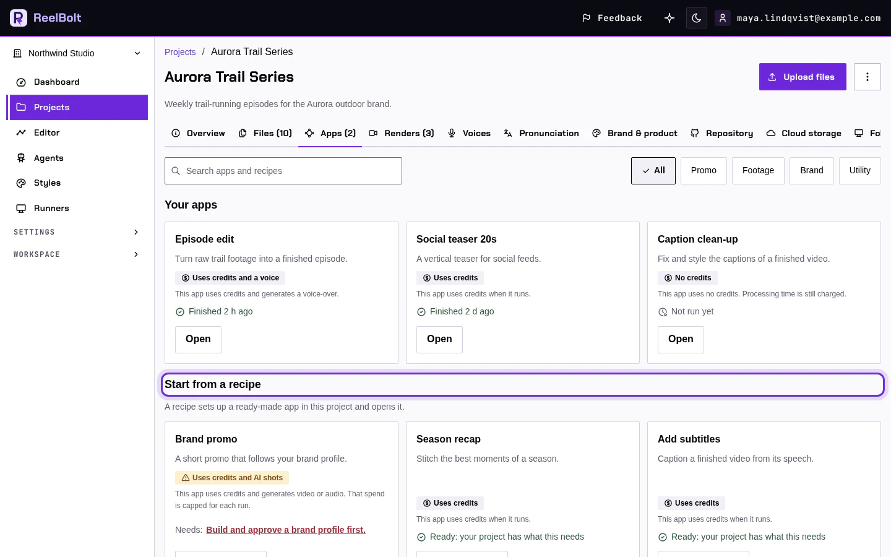
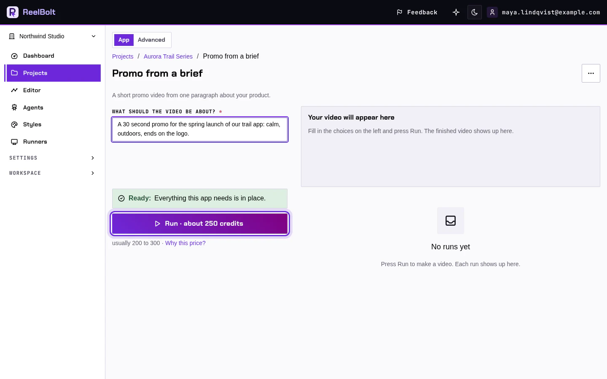

# Pick an app and run it

You will choose a ready-made app for your project and start it. The app makes the video.

## Choose an app

1. Open your project and go to its **Apps** tab.
2. Under **What do you want to make?**, pick the app that matches what you want to make. The app is added to your project and opens.
3. If you already set one up, it is listed under **Your apps**. Click **Open**.

Your project already has one app to start with. Which one depends on what you said the video is made from: **Highlight edit from footage** for clips you shot, or **Promo video from your code** for an app or website you built. It is listed under **Your apps**.

## Check and run

1. Read what the app asks for. Fill in the boxes you see, for example what the video is about, how long it should be and the format. One or two sentences on who the video is for and what it should show are enough. If you are not sure what to write, click one of the **Examples you can edit** under the box and change it to fit.
2. Look for the green **Ready** line, which says everything the app needs is in place. If a line says something is missing, fix that first, for example by uploading a file.
3. Check the price on the **Run** button. This is the number of credits the run is expected to use.
4. Click **Run**. If a confirmation box opens, read it, write your brief if it asks for one, and click **Start run**.

You should see the run start and a message that your video is being made.

:::tip If something looks different
- Your project has a **Workflows** tab instead of **Apps**? Open your app there and click **Run**. What you do next is the same.
- You see **Confirm your email before you run**? A run starts only after your email address is confirmed. Open the link in the email ReelBolt sent you, or click **Resend the email**. You can fill in everything else in the meantime.
- **Run** is greyed out? The line below it says why and what fixes it, such as too few credits.
- Not sure which app to choose? Read [Choose an app](../recipes/choose-a-recipe.md).
:::

## Questions the app asks

Some apps ask their own questions, set up by whoever made the app. Each box has a plain label and grey example text that shows the kind of answer that fits; the example is never sent.

- **Text boxes**: for example what happens in the video or what the person says. A longer box counts the characters you have left.
- **Switches**: for example **Lite mode (cheaper)**. The price on **Run** changes when you flip one, because the app takes a different path.
- **Choices, lengths and shapes**: pick one. A changed length or shape updates the price after a moment.
- **A model**: some apps let you choose the AI model an app uses. Each card shows the model's name, a short note and how its price compares in words, such as **Cheapest** or **About 2× the price**. **Recommended** comes first and is chosen until you pick another. A model that cannot be used here says why. On a phone the cards open from one button at the bottom of the screen.

Settings most people never change sit under **More options**, which starts closed. The app's maker decides what goes there, and the page remembers whether you left it open.

If a required box is empty, **Run** says so and its fix takes you to that box. If a run is refused because of an answer, the reason appears under that box, and **More options** opens if the box is inside it.

## Go deeper

- [Choose an app](../recipes/choose-a-recipe.md)
- [Reading the estimate](../account/reading-the-estimate.md)
- [Run settings](../recipes/run-settings.md)

Next: [Follow progress, then download or share](./follow-progress-and-share.md).
