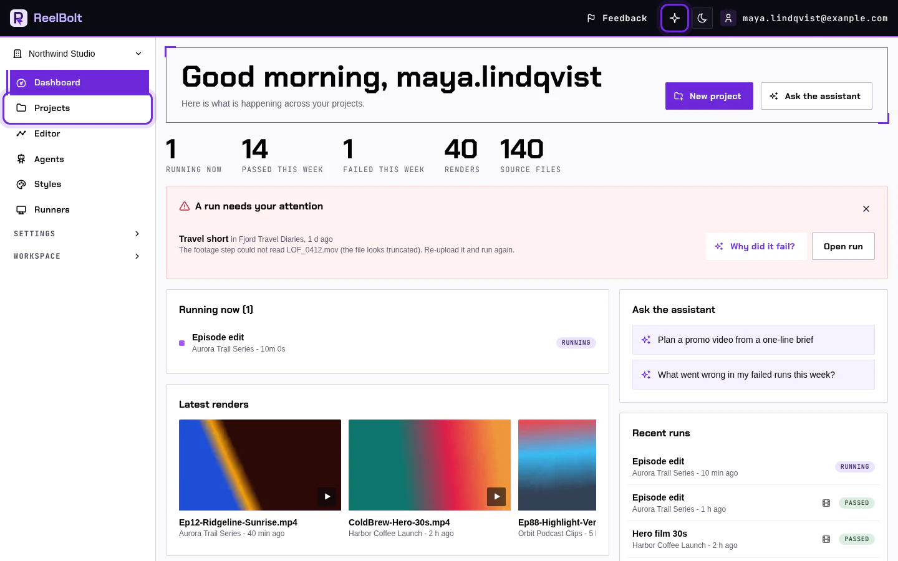
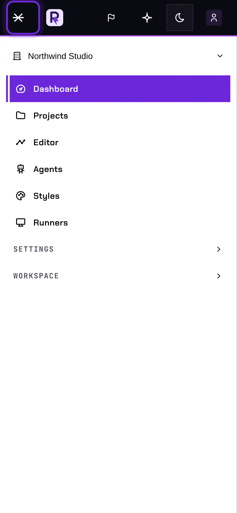

# Sign up and take a first look

You will create your account, answer two quick questions that set up your first project, and find the main places in ReelBolt.

## Create your account and sign in

The fastest way is with an account you already have.

1. Open the sign-up page.
2. Click **Continue with Google** or **Continue with GitHub**, and approve the request. You are asked once to accept the Terms of Service and the Privacy Policy, and then you are in. There is no password to choose and no email to confirm.

To sign up with your email address instead:

1. Under **or sign up with email**, enter your **Name**, your **Email** and a **Password** of at least 10 characters. You type the password once. Click the eye in the password box to check what you typed.
2. Tick the box to accept the Terms of Service and the Privacy Policy. The product-news box below it is optional.
3. Click **Create account**. You should see **Check your email**.
4. Open the confirmation link in the email ReelBolt sends you. The link signs you in. It works once and lasts 24 hours.

Starting is free and no card is asked for.

Until you confirm your email, a yellow **Confirm your email address** bar stays at the top and runs do not start. You can still set everything up in the meantime. Use **Resend the email** on that bar if the message did not arrive.

:::tip If something looks different
- No Google or GitHub button? Your ReelBolt does not offer that way of signing in. Use your email address.
- Inside another app's built-in browser, such as a social app? Google sign-in does not work there. Open the page in your usual browser, or use your email address.
- There is no sign-up page? Your ReelBolt may be run by an administrator who creates accounts. Ask them for your email and a temporary password, sign in, then choose a new password when asked.
- No email? Check your spam folder, then use **Resend email** on the **Check your email** screen.
:::

## Answer two questions

The first time you arrive, ReelBolt asks two questions. Each takes one click, and your answers set up your first project.

1. **What are you here to make a video for?** Pick the closest card, for example **My channel or my followers**, **My business** or **My lessons or my course**, then click **Continue**. Your answer only shapes the examples and tips you see. You can make any kind of video later.
2. **What do you have to start from?** Pick one:
   - **Clips I already shot**: ReelBolt creates a project called **My first video** and opens it where you add your clips.
   - **An app or website I built**: the project opens where you add your code.
   - **Just an idea so far**: you get a list of five short clips to film on your phone. Click **I have my clips. Add them** when you are ready, or **I will film them first** to come back later. Your project is saved either way.

You should now be in your first project, ready to add your material.

:::tip If something looks different
- You see **No clips handy? Try it with our sample clips**? Click it to try ReelBolt with clips we provide. It needs a confirmed email, and only some installations offer it.
- Not ready to answer? Click **Skip for now**. Nothing is set up for you, and the dashboard shows **Start your first video** when you want to come back to the questions. A short tour of the app may start instead; click **Skip tour** to close it.
- You were not asked? The questions appear once, for a new account in a workspace with no projects yet. If you joined a team that already has projects, you go straight to the dashboard.
:::

## Your first video, in three steps

Until you start your first run, the dashboard shows a **Your first video** panel with three tasks. Each task is a link to the place where you do it, and the panel marks which one is next.

1. **Add your clips** (or **Add your code**). Drop in what you already shot. Several different shots make a better edit than one long take.
2. **Say what it is for.** One or two sentences: who the video is for and what it should show. The panel gives an example you can borrow.
3. **Press Run.** You get a first cut to react to. A small job takes minutes, a big one sometimes half an hour. You can leave the page while it works.

If you chose **Just an idea so far**, the panel also has **See your shot list**.

The next three guides walk through these steps: [Create a project and upload files](./create-a-project-and-upload.md), [Pick an app and run it](./pick-an-app-and-run.md) and [Follow progress, then download or share](./follow-progress-and-share.md).

## Find your way around

The menu on the left has the places you use every day:

- **Dashboard**: recent activity and runs in progress.
- **Projects**: one project for each video you make.
- **Editor**: open a video as a timeline, or work on a picture (Early preview).
- **Agents**, **Styles** and **Runners**: the AI workers, the editing looks, and any computers you have connected.

The sparkle button in the top bar opens the **assistant**. **Settings** at the bottom of the menu holds your account, your usage and your plan.

On a phone, the menu is behind the menu button in the top bar. Tap it, pick a place, and the menu closes.

The dashboard also has a **Getting started** list that ticks itself as you go: create a project, upload a file, run your first video, open the result, try the assistant, open the editor. You can dismiss it at any time. For a short guided look at the menu, the assistant and where your videos land, open **Help** in the top bar and click **Take the tour**.

:::tip If something looks different
Some entries only show for some people. **Workspace** appears for workspace owners and admins, and **Platform** only for administrators of the whole installation.
:::

## Go deeper

- [Getting started](../getting-started.md)
- [Workspaces and teams](../workspaces.md)
- [Concepts](../concepts.md)

Next: [Create a project and upload files](./create-a-project-and-upload.md).
