# Control shapes: three proposals for sliders and switches

Status: **proposal**. The three variants are live behind a dev-only preview route, the
`--rb-control-*` tokens are declared in `web/app/global.css`, and **nothing in the shipped app
consumes them yet**. The application PR is a separate step after the owner picks.

The brief's shape language is a rounded parallelogram: the leading and trailing edges lean a few
degrees, the corners stay radiused, and the cyberpunk lean comes from geometry and one restrained
glow, not saturation. All three variants keep Mantine's controls real (no mocks): the preview page
renders Mantine `Slider`, `RangeSlider` and `Switch` and reads the shape tokens back from the
computed style.

## How to see it

```
cd web && npx next dev -p 4711 --turbopack
open http://localhost:4711/app/control-shapes
```

The route is not linked from anywhere and calls `notFound()` when `NODE_ENV === 'production'`
(guard test: `web/app/control-shapes/control-shapes-guard.test.tsx`; isolation test:
`control-shapes-isolation.test.ts`; token contract: `control-shapes-tokens.test.ts`). It needs a
signed-in session like every other non-public route.

The preview deliberately does not wrap controls in `[data-editor-surface]`. A wrapper would turn
on every editor rule for the whole page (`body:has([data-editor-surface])` drives the header,
safe-area and popover rules), which is not free. The editor's control overrides are additive
today, so the preview's `[data-control-variant]` rules and the editor's own rules would simply
stack in the application PR; that is a review item for the application PR, not something the
preview fakes.

## Scope

In scope for the later application PR:

- **Mantine sliders** (`Slider` / `RangeSlider`): 21 files. Fifteen use Mantine's components
  directly (the wrapper included): `web/app/(app)/admin/calibration/page.tsx`,
  `web/components/editor/audio/BusesPanel.tsx`,
  `web/components/editor/color/ColorWorkspace.tsx`,
  `web/components/editor/EditorWorkspace.tsx`,
  `web/components/editor/panels/clip-depth/AnimateSection.tsx`,
  `web/components/editor/panels/clip-depth/ClipControls.tsx`,
  `web/components/editor/phone/AudioSheet.tsx`,
  `web/components/editor/phone/ClipSheet.tsx`,
  `web/components/editor/phone/LookSheet.tsx`,
  `web/components/editor/phone/phone-controls.tsx`,
  `web/components/editor/shell/LiveSlider.tsx`,
  `web/components/editor/thumbnail/BrushPanel.tsx`,
  `web/components/editor/thumbnail/ExportDialog.tsx`,
  `web/components/editor/thumbnail/LayerMaskBar.tsx`,
  `web/components/editor/thumbnail/LayersPanel.tsx`.
  Six more go through the editor's draft-then-commit wrapper:
  `web/components/editor/audio/Fader.tsx`,
  `web/components/editor/audio/MixerPanel.tsx`,
  `web/components/editor/color/GradeStackEditor.tsx`,
  `web/components/editor/color/LookPanel.tsx`,
  `web/components/editor/color/SecondaryFields.tsx`,
  `web/components/editor/compose/ComposeWorkspace.tsx`.
- **Switches**: 47 files, all Mantine. They are styled once (theme entry plus global rules), so the
  application PR does not edit those files.
- **The one native range input**: `web/components/review-guest/GuestReviewPage.tsx` (the guest
  scrubber). It is a bespoke `<input type="range">` with inline styles and needs its own
  `::-webkit-slider-thumb` / `::-moz-range-thumb` rules.

Out of scope, named here so the application PR has a fixed list. These are hand-rolled,
slider-shaped surfaces, not Mantine sliders: `web/components/editor/color/CurveEditor.tsx` (a
curve), `web/components/editor/timeline/TimelineCanvas.tsx` (ruler scrubber),
`web/components/editor/media/*` (hover scrubbing), `web/components/editor/panels/KeyframeLane.tsx`,
and the phone `WordPicker`.

## Tokens: declared, not consumed

Declared in `web/app/global.css` in both scheme blocks (`:root[data-mantine-color-scheme='light']`
and `:root[data-mantine-color-scheme='dark']`). The values are variant **A**. The only consumers
today are `web/app/control-shapes/**`; `control-shapes-tokens.test.ts` fails if any other module
references one of them.

The thumb is exactly **2 x `--rb-control-track-h`**. That is Mantine's own invariant: the fill bar
is `filled% + 2 x size`, the track `::before` is `inset-inline: -size`, and a thumb of `2 x size`
makes the fill end exactly at the knob and the knob reach both visual ends. A smaller knob leaves
a purple stub beyond the fill and stops short of the end.

The palette aliases the app's own tokens (`--rb-surface`, `--rb-ink`, `--rb-ink-text`, `--rb-focus`,
`--rb-accent-deep`, `--rb-accent-ink`, `--rb-accent-strong`, `--rb-accent`) so it cannot drift.
`--rb-control-focus-halo` is the one new token beyond the original list: it is the inner half of
the two-tone focus ring.

| Token | Meaning |
| --- | --- |
| `--rb-control-slant` | skewX angle of the track (and therefore its children) |
| `--rb-control-track-h` | visible track height; the thumb is 2 x this |
| `--rb-control-track-radius` | track and fill corner radius |
| `--rb-control-thumb-size` | slider thumb square size |
| `--rb-control-thumb-radius` | slider thumb corner radius |
| `--rb-control-thumb-rim` | slider thumb rim width |
| `--rb-control-track-bg` | track surface |
| `--rb-control-track-bg-disabled` | muted track surface |
| `--rb-control-fill-bg` | filled portion |
| `--rb-control-fill-bg-disabled` | muted filled portion |
| `--rb-control-thumb-bg` | slider thumb fill (aliases `--rb-surface` / `--rb-ink`) |
| `--rb-control-thumb-rim-color` | slider thumb rim; also the B rim on the track and switch |
| `--rb-control-glow` | active-thumb box-shadow (A/C: `none`) |
| `--rb-control-focus` | outer focus-ring colour (aliases `--rb-focus`) |
| `--rb-control-focus-halo` | inner focus-ring halo, measured against fill/track |
| `--rb-control-hit` | minimum touch target and thumb hit extension |
| `--rb-control-switch-w` / `-h` / `-radius` | switch track geometry |
| `--rb-control-switch-thumb` | switch thumb size |
| `--rb-control-switch-off-bg` / `--rb-control-switch-on-bg` | switch states |
| `--rb-control-switch-thumb-bg` | switch thumb fill (aliases `--rb-surface` / `--rb-ink`) |

### Variant A token block (the defaults in `global.css`)

```css
:root[data-mantine-color-scheme='light'] {
  --rb-control-slant: 8deg;
  --rb-control-track-h: 16px;
  --rb-control-track-radius: 4px;
  --rb-control-thumb-size: 32px;
  --rb-control-thumb-radius: 4px;
  --rb-control-thumb-rim: 2px;
  --rb-control-track-bg: #8c849a;
  --rb-control-track-bg-disabled: #d6d2e1;
  --rb-control-fill-bg: #4c1d95;
  --rb-control-fill-bg-disabled: #b9b3c8;
  --rb-control-thumb-bg: var(--rb-surface);
  --rb-control-thumb-rim-color: var(--rb-accent-deep);
  --rb-control-glow: none;
  --rb-control-focus: var(--rb-focus);
  --rb-control-focus-halo: var(--rb-ink-text);
  --rb-control-hit: 44px;
  --rb-control-switch-w: 46px;
  --rb-control-switch-h: 26px;
  --rb-control-switch-radius: 6px;
  --rb-control-switch-thumb: 20px;
  --rb-control-switch-off-bg: #8c849a;
  --rb-control-switch-on-bg: var(--rb-accent-strong);
  --rb-control-switch-thumb-bg: var(--rb-surface);
}
:root[data-mantine-color-scheme='dark'] {
  --rb-control-slant: 8deg;
  --rb-control-track-h: 16px;
  --rb-control-track-radius: 4px;
  --rb-control-thumb-size: 32px;
  --rb-control-thumb-radius: 4px;
  --rb-control-thumb-rim: 2px;
  --rb-control-track-bg: #6a6478;
  --rb-control-track-bg-disabled: #2e2a3a;
  --rb-control-fill-bg: #c4b5fd;
  --rb-control-fill-bg-disabled: #4f4a5d;
  --rb-control-thumb-bg: var(--rb-ink);
  --rb-control-thumb-rim-color: var(--rb-accent-ink);
  --rb-control-glow: none;
  --rb-control-focus: var(--rb-focus);
  --rb-control-focus-halo: var(--rb-ink);
  --rb-control-hit: 44px;
  --rb-control-switch-w: 46px;
  --rb-control-switch-h: 26px;
  --rb-control-switch-radius: 6px;
  --rb-control-switch-thumb: 20px;
  --rb-control-switch-off-bg: #6a6478;
  --rb-control-switch-on-bg: var(--rb-accent);
  --rb-control-switch-thumb-bg: var(--rb-ink);
}
```

Geometry is theme-independent and is repeated in both blocks so each scheme block is
self-contained. B and C override the geometry tokens in the preview CSS; their colour tokens are
the same as A, because one palette serves all three shapes. Resolved values: light thumb
`#ffffff`, rim `#2e1065`, focus `#6d28d9`, halo `#f5f3f8`; dark thumb `#0b0b12`, rim `#c4b5fd`,
focus `#c4b5fd`, halo `#0b0b12`.

### The two-thumb case

`RangeSlider` shares the track, the bar and the thumb rules (the preview targets
`.mantine-RangeSlider-*` alongside `.mantine-Slider-*`). Both thumbs are children of the same
skewed track, so both are sheared about the same centre line, both reach the visual ends at 0 and
100, and the bar between them ends exactly at the two thumbs' outer edges (measured 0 px
difference). Each thumb gets its own focus ring and its own 44 px hit extension; the drag mapping
is per thumb and still clamps at the visual ends. No extra CSS is needed for the two-thumb case
beyond the shared selectors.

## Density and the track height

The lean is proportional to height: at the ends the horizontal run is `tan(angle) x height`.
A: `tan 8 deg x 16px = 2.25px`; B: `tan 15 deg x 18px = 4.82px`; C:
`tan 5 deg x 16px = 1.40px`. At Mantine's default 8px the same runs are 1.12, 2.14 and 0.70px;
at the editor's `size="xs"` 4px they are 0.56, 1.07 and 0.35px, which no one will read as anything
but a rounded rectangle.

The thumb is 2 x the track (32, 36 and 32px). The editor already forces a 24 px thumb
(`web/app/global.css:287-290`), so the new knob is 1.33 to 1.5 times the current editor thumb, not
a new order of magnitude. The track itself is 4 to 4.5 times the editor's 4 px `xs` track (2 to
2.25 times Mantine's default 8 px), so the visual weight changes more than the word "doubling"
suggests.

The preview also sets a 44 px root and `trackContainer` row (`--rb-control-hit`). That is a real
cost: the editor's `xs` root row is 8 px tall and its thumb 24 px, so a 44 px row adds about 36 px
of vertical space per slider in a dense inspector. **Recommendation:** ship the 44 px row app-wide
**on coarse pointers only** (`@media (pointer: coarse)`), and keep the fine-pointer row at the
thumb/track height or the editor's existing 24 px minimum. Touch keeps the 44 px target; desktop
density does not grow by a row it does not need.

The application PR has two ways to resolve the track height:

1. **One height everywhere.** The shape always reads. Risk: inspector panels that use 4 px tracks
   today go to 16 to 18 px, 4 to 4.5 times their current height.
2. **A size-scaled `--rb-control-track-h`** (xs/sm/md keep Mantine's `size`). Density is preserved.
   Risk: xs sliders show 0.35 to 1.07 px of lean, which undercuts the shape exactly where the
   editor is densest.

Recommendation: one height everywhere for the first application PR, because the shape is the
deliverable; tune dense panels in a later density pass. The choice lives in
`--rb-control-track-h` (track height) and `--rb-control-hit` (the 44 px row), not in the preview
CSS.

## Contrast, measured

Recomputed from the declarations in `web/app/global.css` by
`docs/design/control-shapes/contrast.mjs` (plain Node, WCAG relative luminance; the script strips
comments and resolves the `var()` aliases). Run:

```
node docs/design/control-shapes/contrast.mjs
```

Real output:

```

## Light

| Pair | Foreground | Background | Ratio | Required | Result |
| --- | --- | --- | ---: | ---: | --- |
| track vs page background | #8c849a | #faf9fc | 3.40:1 | 3:1 | PASS |
| thumb vs track | #ffffff | #8c849a | 3.57:1 | 3:1 | PASS |
| switch off vs page background | #8c849a | #faf9fc | 3.40:1 | 3:1 | PASS |
| switch on vs page background | #6d28d9 | #faf9fc | 6.77:1 | 3:1 | PASS |
| switch thumb vs off track | #ffffff | #8c849a | 3.57:1 | 3:1 | PASS |
| switch thumb vs on track | #ffffff | #6d28d9 | 7.10:1 | 3:1 | PASS |
| focus ring (outer) vs page background | #6d28d9 | #faf9fc | 6.77:1 | 3:1 | PASS |
| focus halo vs fill | #f5f3f8 | #4c1d95 | 9.94:1 | 3:1 | PASS |
| focus halo vs track | #f5f3f8 | #8c849a | 3.24:1 | 3:1 | PASS |
| fill vs track (extra) | #4c1d95 | #8c849a | 3.07:1 | 3:1 | PASS (advisory) |
| thumb rim vs track (extra) | #2e1065 | #8c849a | 4.27:1 | 3:1 | PASS (advisory) |
| disabled label vs page background (text, extra) | #625d70 | #faf9fc | 6.03:1 | 4.5:1 | PASS (advisory) |
| disabled track vs page (inactive, extra) | #d6d2e1 | #faf9fc | 1.41:1 | 3:1 | FAIL (advisory) |
| disabled thumb vs disabled track (inactive, extra) | #8c849a | #d6d2e1 | 2.41:1 | 3:1 | FAIL (advisory) |
| disabled fill vs disabled track (inactive, extra) | #b9b3c8 | #d6d2e1 | 1.37:1 | 3:1 | FAIL (advisory) |

## Dark

| Pair | Foreground | Background | Ratio | Required | Result |
| --- | --- | --- | ---: | ---: | --- |
| track vs page background | #6a6478 | #0b0b12 | 3.46:1 | 3:1 | PASS |
| thumb vs track | #0b0b12 | #6a6478 | 3.46:1 | 3:1 | PASS |
| switch off vs page background | #6a6478 | #0b0b12 | 3.46:1 | 3:1 | PASS |
| switch on vs page background | #a855f7 | #0b0b12 | 4.96:1 | 3:1 | PASS |
| switch thumb vs off track | #0b0b12 | #6a6478 | 3.46:1 | 3:1 | PASS |
| switch thumb vs on track | #0b0b12 | #a855f7 | 4.96:1 | 3:1 | PASS |
| focus ring (outer) vs page background | #c4b5fd | #0b0b12 | 10.62:1 | 3:1 | PASS |
| focus halo vs fill | #0b0b12 | #c4b5fd | 10.62:1 | 3:1 | PASS |
| focus halo vs track | #0b0b12 | #6a6478 | 3.46:1 | 3:1 | PASS |
| fill vs track (extra) | #c4b5fd | #6a6478 | 3.07:1 | 3:1 | PASS (advisory) |
| thumb rim vs track (extra) | #c4b5fd | #6a6478 | 3.07:1 | 3:1 | PASS (advisory) |
| disabled label vs page background (text, extra) | #a79fb4 | #0b0b12 | 7.71:1 | 4.5:1 | PASS (advisory) |
| disabled track vs page (inactive, extra) | #2e2a3a | #0b0b12 | 1.41:1 | 3:1 | FAIL (advisory) |
| disabled thumb vs disabled track (inactive, extra) | #6a6478 | #2e2a3a | 2.46:1 | 3:1 | FAIL (advisory) |
| disabled fill vs disabled track (inactive, extra) | #4f4a5d | #2e2a3a | 1.64:1 | 3:1 | FAIL (advisory) |

Required pairs: WCAG 1.4.11 non-text 3:1. The two-tone focus ring measures the
outer ring against the page and the halo against the fill and the track.
Disabled pairs are advisory (WCAG 1.4.11 exempts inactive components).
RESULT: PASS
```

The focus indicator is two-tone because one colour cannot clear the light page, the mid-gray track
and the dark fill at once. The outer 2 px ring sits on the page (`6.77:1` / `10.62:1`); the inner
2 px halo sits next to the thumb and is measured against the fill (`9.94:1` / `10.62:1`) and the
track (`3.24:1` / `3.46:1`). On the sides, where the ring crosses the fill and the track, the halo
is the band that reads; on the top and bottom arcs, the outer ring is. The disabled pairs are
listed so the 1.4.11 exemption is explicit, not hidden.

The table is the same for A, B and C: the three variants share one palette and differ only in
geometry (the B rim uses the same rim token, so the shared rows apply). The per-variant sections
below repeat the required rows so each proposal can be reviewed on its own.

## Empirical checks (browser, Chrome 155, dev server)

Both original risks were settled against the real Mantine DOM, and the geometry was re-measured
after the thumb became 2 x the track:

- **Disabled slider thumb.** Mantine hides it (`.m_c9a9a60a:where([data-disabled]) { display:
  none }` in `Slider.css`). The proposal puts the knob back (`display: flex`) and gives it a muted
  fill plus a halved rim, so a disabled slider keeps the same anatomy as a disabled switch. The
  application PR must carry that one override.
- **End geometry.** With `skewX` on the track and a thumb of 2 x the track height, the thumb's
  centre line is unchanged, so Mantine's `left: var(--slider-thumb-offset)` still maps correctly.
  Measured: at 0 the thumb's centre-line edge is on the visual track's left end; at 100 it is on
  the right end. At 25, 50 and 100 the fill bar's edge coincides with the thumb's edge (the small
  bounding-box difference is the skew shear of the taller thumb, not a fill overhang). The 0 %
  slider and the `RangeSlider` row are on the page to show both cases.
- **Hit areas.** The 44 px hit row is real: a click 2 px from the top of the `trackContainer`
  (14 px above a 16 px track) moves the value. The thumb's `::after` is a 44 px box centred on the
  thumb, so it reaches 6 px beyond a 32 px thumb (4 px beyond B's 36 px thumb). The QA pointer probe
  measured a hit box of 44-46 px depending on the shear, never below 44; the axis-aligned bounding
  box of the sheared box is wider than that and is not the target. The switch's labelled body is
  44 px tall and a click on the label toggles it.
- **Focus.** Forced `:focus-visible` paints the two-tone ring on the slider thumb, the RangeSlider
  thumbs and the slanted switch track; B adds its glow with the ring, never instead of it. On the
  switch the halo is page-coloured and therefore does nothing: the outer outline alone carries that
  focus, and it clears 3:1 on both themes. The colour pairs are in the measured table above.

---

# Variant A: soft slant

The conservative shape. Eight degrees is enough to move the ends visibly on a 16 px track
(about 2.25 px of run) while the 4 px radius keeps the shoulders soft. The 32 px thumb (2 x the
track) is white in light and near-black in dark, with a 2 px rim and a 4 px radius that matches the
track. There is no glow, so the control stays quiet in dense editor panels. The focus ring is the
two-tone ring shared by all variants.

## Token block (light / dark)

Same colours as the token block above; the variant's geometry is the default. Light / dark
colours: track `#8c849a` / `#6a6478`, track disabled `#d6d2e1` / `#2e2a3a`, fill `#4c1d95` /
`#c4b5fd`, fill disabled `#b9b3c8` / `#4f4a5d`, thumb `#ffffff` / `#0b0b12`, rim `#2e1065` /
`#c4b5fd`, focus `#6d28d9` / `#c4b5fd`, halo `#f5f3f8` / `#0b0b12`, switch off `#8c849a` /
`#6a6478`, switch on `#6d28d9` / `#a855f7`, switch thumb `#ffffff` / `#0b0b12`.

```css
/* light and dark share geometry */
--rb-control-slant: 8deg;
--rb-control-track-h: 16px;
--rb-control-track-radius: 4px;
--rb-control-thumb-size: 32px;
--rb-control-thumb-radius: 4px;
--rb-control-thumb-rim: 2px;
--rb-control-switch-w: 46px;
--rb-control-switch-h: 26px;
--rb-control-switch-radius: 6px;
--rb-control-switch-thumb: 20px;
--rb-control-glow: none;
```

The radius set is proportional, not three arbitrary values: the track radius is 4 on 16 px (25 %),
the thumb radius is 4 on 32 px (12.5 %, a sharper knob), and the switch radius is 6 on 26 px
(23 %, the same shoulder proportion as the track). A pill switch would fight the parallelogram.

## Measured contrast

| Pair | Light | Dark | Required | Result |
| --- | ---: | ---: | ---: | --- |
| track vs page background | 3.40:1 | 3.46:1 | 3:1 | PASS |
| thumb vs track | 3.57:1 | 3.46:1 | 3:1 | PASS |
| switch off vs page background | 3.40:1 | 3.46:1 | 3:1 | PASS |
| switch on vs page background | 6.77:1 | 4.96:1 | 3:1 | PASS |
| switch thumb vs off track | 3.57:1 | 3.46:1 | 3:1 | PASS |
| switch thumb vs on track | 7.10:1 | 4.96:1 | 3:1 | PASS |
| focus ring (outer) vs page | 6.77:1 | 10.62:1 | 3:1 | PASS |
| focus halo vs fill | 9.94:1 | 10.62:1 | 3:1 | PASS |
| focus halo vs track | 3.24:1 | 3.46:1 | 3:1 | PASS |
| fill vs track (extra) | 3.07:1 | 3.07:1 | 3:1 | PASS |
| thumb rim vs track (extra) | 4.27:1 | 3.07:1 | 3:1 | PASS |
| disabled label vs page (text, extra) | 6.03:1 | 7.71:1 | 4.5:1 | PASS |

## Cost

- **Hooks.** `web/app/theme.ts` can carry the plain geometry (`Slider.styles` and
  `RangeSlider.styles` for root/track/bar/thumb radius, `Switch.styles` for track/thumb radius) and
  the skew (`track.transform`). The track `::before`, the thumb `::after` hit extension,
  `:focus-visible`, the disabled thumb visibility, the two-tone ring and the switch
  `:checked`/`:disabled` sibling rules must live in `web/app/global.css` on `.mantine-Slider-*`,
  `.mantine-RangeSlider-*` and `.mantine-Switch-*`, because theme styles cannot address
  pseudo-elements or sibling combinators.
- **JS.** None. The shape is CSS only; Mantine's drag and keyboard behaviour are untouched.
- **Browser support.** `transform: skewX`, `::before`/`::after`, `outline` and `box-shadow` are
  universal. No `color-mix` in A.
- **Phone surface.** The visual track is 16 px, but the hit row is 44 px and the thumb is 32 px
  with a 44 px `::after`, so the 44 px target is satisfied. The 44 px row should be gated to coarse
  pointers in the application PR (see Density).
- **Maintenance.** One theme entry plus a scoped global block. The tokens are the single source;
  changing the slant or height touches no component.

## Theme hooks

| Surface | Where |
| --- | --- |
| `Slider` | `theme.ts` `components.Slider.styles` (new) + `global.css` `.mantine-Slider-track::before`, `.mantine-Slider-thumb::after`, the two-tone `:focus-visible`, `[data-disabled]` |
| `RangeSlider` | same rules as `Slider`; Mantine uses `.mantine-RangeSlider-*` class names, so the application PR must pair the selectors |
| `Switch` | `theme.ts` `components.Switch.styles` (extend the existing radius entry) + `global.css` `.mantine-Switch-input:checked + .mantine-Switch-track` and the disabled rules |
| Native range (`GuestReviewPage`) | out of scope for A; a bespoke rule if the owner wants it |

# Variant B: blade

The cyberpunk one, held back by geometry and restraint. Fifteen degrees on an 18 px track gives a
clear 4.82 px of run at the ends, the 3 px radius keeps the corners tight, and the 1 px rim on the
track surface, the fill, the slider thumb, the switch track and the switch thumb makes the edge
read as a machined blade. The 36 px thumb is 2 x the track, so the fill ends exactly at the knob
and the knob reaches both visual ends. The glow appears only while the thumb is hovered, dragged or
keyboard-focused, and only as a soft 10 px halo in the focus colour; nothing else on the control
glows.

## Token block (light / dark)

Colours identical to A. Light / dark: track `#8c849a` / `#6a6478`, fill `#4c1d95` /
`#c4b5fd`, thumb `#ffffff` / `#0b0b12`, rim `#2e1065` / `#c4b5fd`, focus `#6d28d9` / `#c4b5fd`,
halo `#f5f3f8` / `#0b0b12`, switch off/on `#8c849a`/`#6d28d9` and `#6a6478`/`#a855f7`, switch
thumb `#ffffff` / `#0b0b12`. Geometry overrides:

```css
/* light and dark share geometry */
--rb-control-slant: 15deg;
--rb-control-track-h: 18px;
--rb-control-track-radius: 3px;
--rb-control-thumb-size: 36px;
--rb-control-thumb-radius: 3px;
--rb-control-thumb-rim: 1px;
--rb-control-switch-w: 46px;
--rb-control-switch-h: 26px;
--rb-control-switch-radius: 3px;
--rb-control-switch-thumb: 18px;
--rb-control-glow: 0 0 10px 2px color-mix(in srgb, var(--rb-control-focus) 40%, transparent);
```

## Measured contrast

| Pair | Light | Dark | Required | Result |
| --- | ---: | ---: | ---: | --- |
| track vs page background | 3.40:1 | 3.46:1 | 3:1 | PASS |
| thumb vs track | 3.57:1 | 3.46:1 | 3:1 | PASS |
| switch off vs page background | 3.40:1 | 3.46:1 | 3:1 | PASS |
| switch on vs page background | 6.77:1 | 4.96:1 | 3:1 | PASS |
| switch thumb vs off track | 3.57:1 | 3.46:1 | 3:1 | PASS |
| switch thumb vs on track | 7.10:1 | 4.96:1 | 3:1 | PASS |
| focus ring (outer) vs page | 6.77:1 | 10.62:1 | 3:1 | PASS |
| focus halo vs fill | 9.94:1 | 10.62:1 | 3:1 | PASS |
| focus halo vs track | 3.24:1 | 3.46:1 | 3:1 | PASS |
| fill vs track (extra) | 3.07:1 | 3.07:1 | 3:1 | PASS |
| thumb rim vs track (extra) | 4.27:1 | 3.07:1 | 3:1 | PASS |
| disabled label vs page (text, extra) | 6.03:1 | 7.71:1 | 4.5:1 | PASS |

The B rim against the on-state switch track is 2.14:1 in both themes. It is decorative (state is
carried by the thumb at 4.96:1 / 7.10:1 against the on track), so it is not a required pair.

## Cost

- **Hooks.** As A, plus the 1 px rim on five surfaces: `.mantine-Slider-track::before`,
  `.mantine-Slider-bar`, `.mantine-Slider-thumb`, `.mantine-Switch-track` and
  `.mantine-Switch-thumb` (and the same rules for `.mantine-RangeSlider-*`). The switch track
  also needs `overflow: visible` (it clips its children by default, which would hide the thumb
  glow), and the `:hover` / `[data-dragging]` / `:focus-visible` box-shadow rules. Those belong in
  `global.css`. The rims are `border` with `box-sizing: border-box`, so they sit inside the track
  and the switch thumb and change neither the measured height nor the drag mapping. The disabled
  rim is reset to `--rb-control-track-bg-disabled`.
- **Out-ranking the existing rule.** B's switch-track rim must beat `html :is(.mantine-Checkbox-input,
  .mantine-Radio-radio, .mantine-Switch-track):not(:checked) { border-color:
  var(--rb-border-strong) }` (`web/app/global.css:543`), so the rim selector includes
  `.mantine-Switch-root .mantine-Switch-track`, not the track class alone.
- **JS.** None.
- **Browser support.** The glow uses `color-mix()` (Chrome 111+, Safari 16.2+, Firefox 113+); the
  repository already uses `color-mix()` in `theme.ts` and `global.css`, so it ships today. In a
  browser without it the glow is simply absent; the shape, rim and focus ring still work.
- **Phone surface.** Same hit geometry as A. `overflow: visible` on the switch track is safe
  because the thumb never leaves the track.
- **Maintenance.** More CSS than A (the rims, the muted disabled rim, `overflow` and the glow
  selectors), no component work.

## Theme hooks

| Surface | Where |
| --- | --- |
| `Slider` | theme + `global.css` (A's block plus the 1 px rim on `::before`, the bar and the thumb, and the glow selectors) |
| `RangeSlider` | same rules as `Slider`, under the `.mantine-RangeSlider-*` class names |
| `Switch` | theme + `global.css` (A's block plus the 1 px track and thumb rim, the higher-specificity rim selector, `overflow: visible`, and the thumb glow on row hover / input focus) |
| Native range | out of scope for B |

# Variant C: capsule cut

The least intrusive. A large radius makes the body a capsule, and a five degree lean is just
enough to cut the ends without turning the body into a parallelogram. The 32 px thumb (2 x the
track) is a capsule too, so the control reads as a soft pill that has been sliced at the tips. It
is the safest fit for the dashboard and admin surfaces, where a strong angle would compete with
the content.

## Token block (light / dark)

Colours identical to A. Light / dark: track `#8c849a` / `#6a6478`, fill `#4c1d95` /
`#c4b5fd`, thumb `#ffffff` / `#0b0b12`, rim `#2e1065` / `#c4b5fd`, focus `#6d28d9` / `#c4b5fd`,
halo `#f5f3f8` / `#0b0b12`, switch off/on `#8c849a`/`#6d28d9` and `#6a6478`/`#a855f7`, switch
thumb `#ffffff` / `#0b0b12`. Geometry overrides:

```css
/* light and dark share geometry */
--rb-control-slant: 5deg;
--rb-control-track-h: 16px;
--rb-control-track-radius: 999px;
--rb-control-thumb-size: 32px;
--rb-control-thumb-radius: 999px;
--rb-control-thumb-rim: 2px;
--rb-control-switch-w: 48px;
--rb-control-switch-h: 26px;
--rb-control-switch-radius: 999px;
--rb-control-switch-thumb: 20px;
--rb-control-glow: none;
```

## Measured contrast

| Pair | Light | Dark | Required | Result |
| --- | ---: | ---: | ---: | --- |
| track vs page background | 3.40:1 | 3.46:1 | 3:1 | PASS |
| thumb vs track | 3.57:1 | 3.46:1 | 3:1 | PASS |
| switch off vs page background | 3.40:1 | 3.46:1 | 3:1 | PASS |
| switch on vs page background | 6.77:1 | 4.96:1 | 3:1 | PASS |
| switch thumb vs off track | 3.57:1 | 3.46:1 | 3:1 | PASS |
| switch thumb vs on track | 7.10:1 | 4.96:1 | 3:1 | PASS |
| focus ring (outer) vs page | 6.77:1 | 10.62:1 | 3:1 | PASS |
| focus halo vs fill | 9.94:1 | 10.62:1 | 3:1 | PASS |
| focus halo vs track | 3.24:1 | 3.46:1 | 3:1 | PASS |
| fill vs track (extra) | 3.07:1 | 3.07:1 | 3:1 | PASS |
| thumb rim vs track (extra) | 4.27:1 | 3.07:1 | 3:1 | PASS |
| disabled label vs page (text, extra) | 6.03:1 | 7.71:1 | 4.5:1 | PASS |

## Cost

- **Hooks.** Same as A. The 999 px radii are geometry tokens, not per-component values.
- **JS.** None.
- **Browser support.** Universal (`border-radius` + `skewX`).
- **Phone surface.** Same 44 px hit geometry; gate the 44 px row to coarse pointers as in A.
- **Maintenance.** Same as A.

## Theme hooks

| Surface | Where |
| --- | --- |
| `Slider` | `theme.ts` + `global.css` (A's block, radius tokens changed) |
| `RangeSlider` | same rules as `Slider`, under the `.mantine-RangeSlider-*` class names |
| `Switch` | `theme.ts` + `global.css` (A's block, radius tokens changed) |
| Native range | out of scope for C |

---

# What the application PR would touch

After the owner picks, the application change is presentation only:

1. `web/app/theme.ts`: add `components.Slider.styles` and `components.RangeSlider.styles`
   (root/track/bar/thumb radius, skew) and extend `components.Switch.styles` (already
   `{ track: { borderRadius: 2 }, thumb: { borderRadius: 1 } }`).
2. `web/app/global.css`: the `--rb-control-*` token values for the chosen variant, plus the
   `.mantine-Slider-*` / `.mantine-RangeSlider-*` / `.mantine-Switch-*` rules that cannot live in
   theme styles: pseudo-elements, sibling selectors, disabled thumb visibility, the two-tone
   focus ring, B's rim (which must out-rank the existing
   `html :is(.mantine-Checkbox-input, .mantine-Radio-radio, .mantine-Switch-track):not(:checked)`
   border rule at `web/app/global.css:543`), the 44 px root/trackContainer row, and the
   `prefers-reduced-motion` override.
   Check one measurement in dense rows: A and C's focus indicator is exactly the 44 px row, but B's
   is 48 px (a 36 px thumb plus the 12 px ring), so a dense editor row or a scroll container that
   clips to 44 px would shave the ring. Nothing clips it in the preview, and the application PR
   should check the editor's `size="xs"` sliders before shipping B there.
3. `web/components/review-guest/GuestReviewPage.tsx`: only if the owner wants the guest scrubber to
   match: a bespoke `::-webkit-slider-thumb` / `::-moz-range-thumb` rule for its native
   `<input type="range">`. It is not a Mantine control.
4. No per-file edits for the 21 slider files or the 47 switch call sites: they inherit from the
   theme and global rules. `web/components/editor/shell/LiveSlider.tsx` needs no change. The
   RangeSlider variants share the Slider rules.
5. Out of scope (named above): the hand-rolled curve, ruler, scrubbers, keyframe lane and
   `WordPicker`. They can be revisited in a separate ticket if the owner asks.

# Screenshots

T-002 adds the images and re-shoots after the geometry change. The slots are fixed:

## A, light
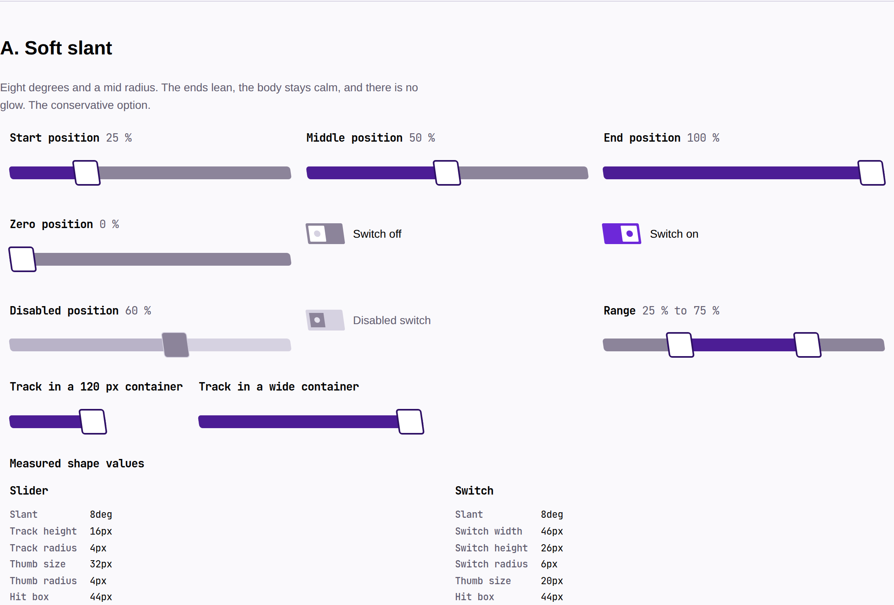
## A, dark
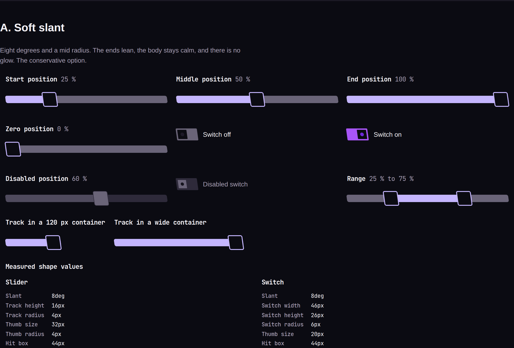

## B, light
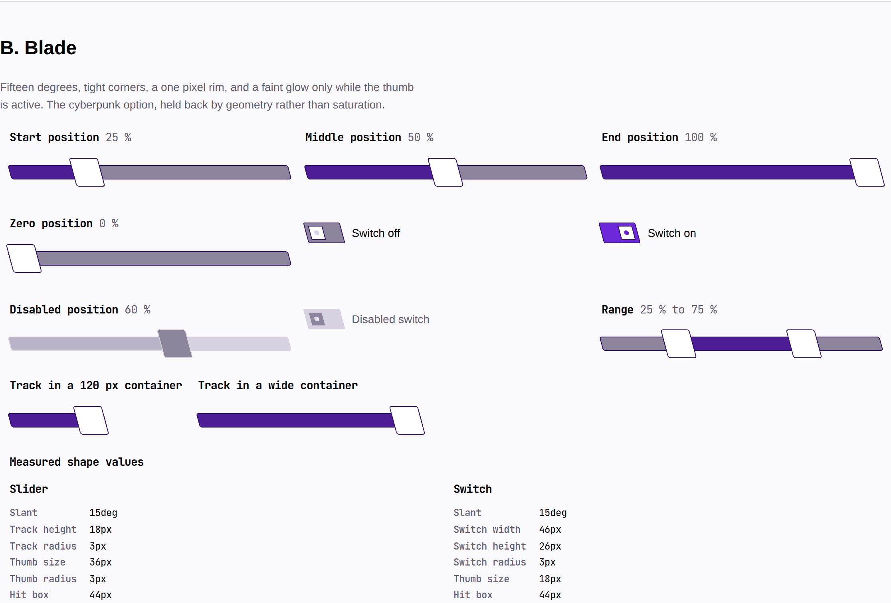
## B, dark
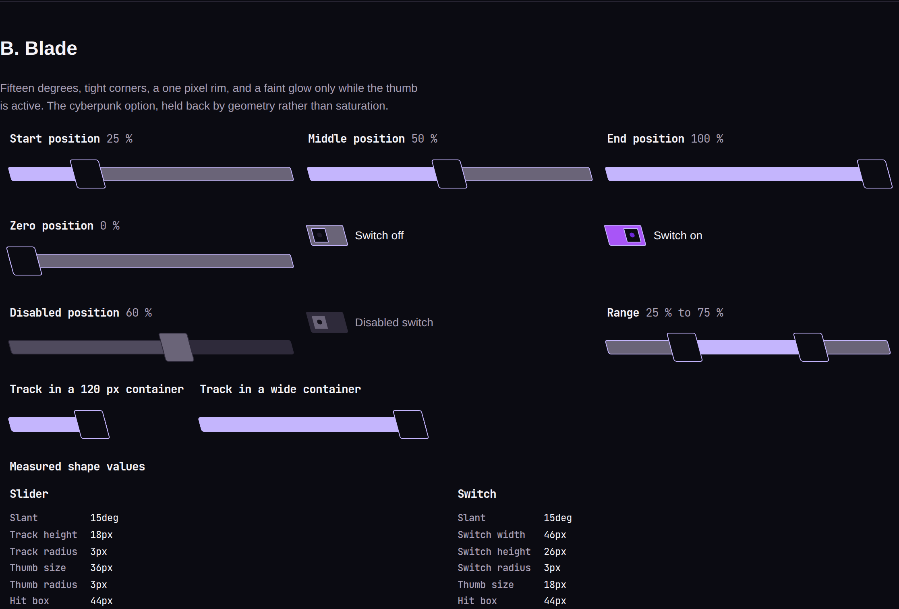

## C, light

## C, dark
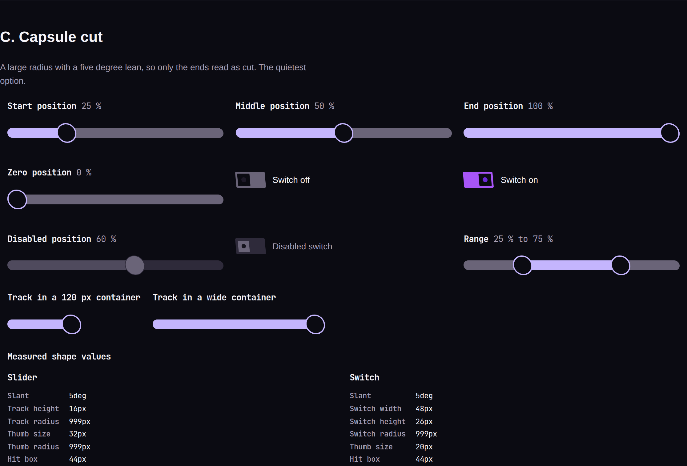

## Phone, light

## Phone, dark


## B, active thumb (hover)
The glow exists only while the thumb is hovered, dragged or keyboard-focused; a resting shot cannot
show it. Light, then dark.

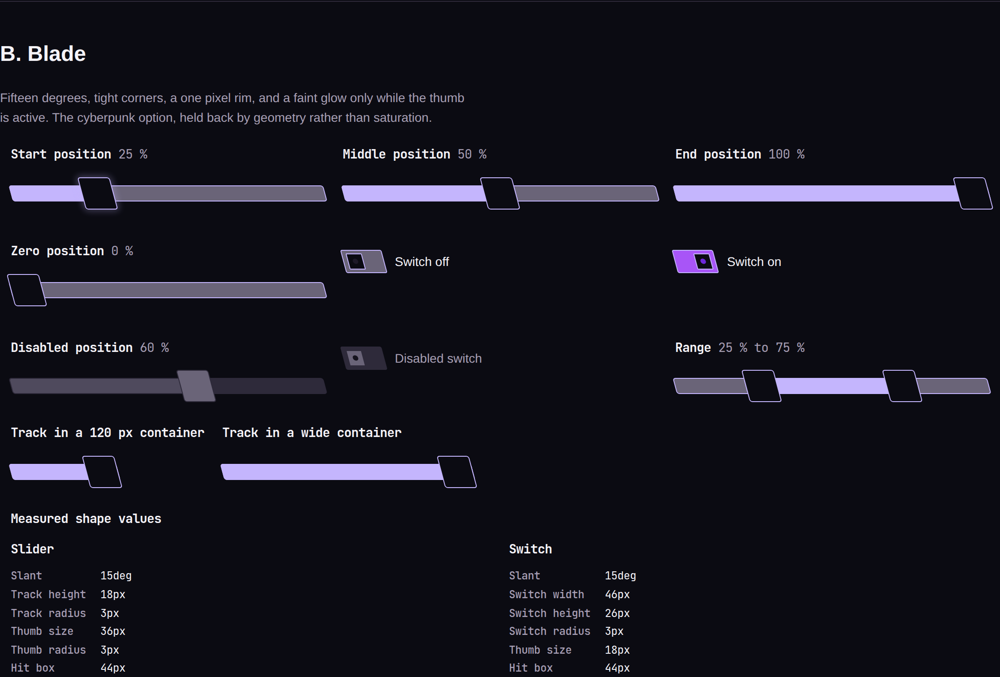

## B, keyboard focus
Real `Tab` focus. Both shots are the 50 % thumb, so the two themes show the same control. Both show
the two-tone ring (outer outline plus inner halo) following the slanted shape; B adds its glow with
the ring, and the value tooltip is Mantine's own. Light, then dark.
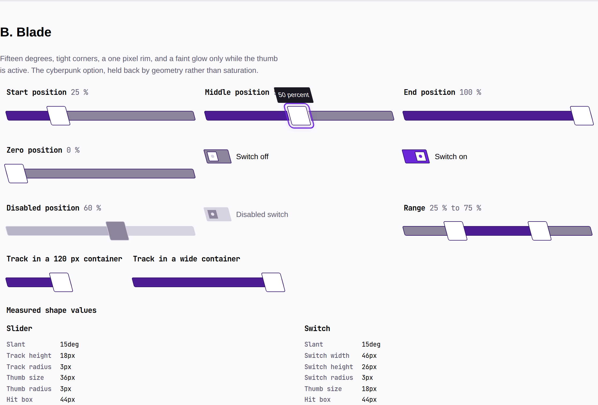
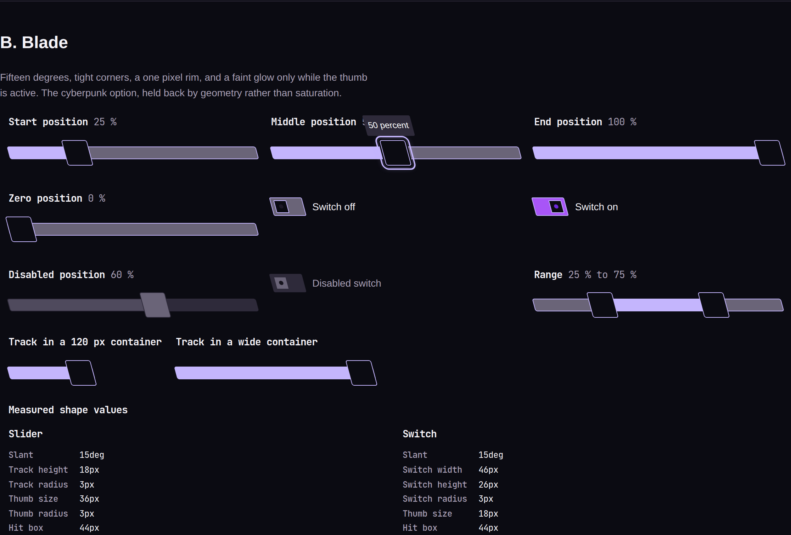

# Pick

I would pick **B, blade**. It is the only one of the three where the brief's "rounded
parallelogram" is legible at a glance rather than as a hint: the 15 degree ends and the tight
corners read as a shape, the 1 px rim gives the cyberpunk edge without saturation, and the glow is
confined to the active thumb so dense panels stay calm. A is a good fallback for the dashboard and
admin surfaces, where the shape language should not compete with content; C is the least risky but
its capsule with a 5 degree cut is almost indistinguishable from today's controls in a screenshot,
so it does not answer the owner's "meno quadrati" as directly.

Cost: A and C are one theme entry plus the global pseudo-element block, no JS; B adds the 1 px
rims, one `overflow` rule, the muted disabled rim and three glow selectors, and depends on
`color-mix()` for the glow colour (already used elsewhere in the repo). None needs JavaScript.

# Applied in the app: B, blade

The owner picked **B** on 2026-10-30. The application change is presentation only: no component,
pointer, hit-area or drag logic was edited, and no copy changed. Everything below is the shape the
product ships, and the dev-only preview's `Applied in the app (no variant override)` section renders
it without any override so the screenshots next to this document are the measurement.

## Where it lands

| Surface | File | What changed |
| --- | --- | --- |
| Tokens | `web/app/global.css` | The `--rb-control-*` values are B. `--rb-control-track-h-{xs,sm,md,lg,xl}` and the switch size tokens are new; the colour tokens are unchanged from the proposal. |
| Slider, RangeSlider | `web/app/theme.ts` | `--slider-radius` points at `--rb-control-thumb-radius`; the thumb's width and height are `--rb-control-thumb-size`. |
| Switch | `web/app/theme.ts` | Track and thumb radius become `--rb-control-switch-radius` (3 px, was 2/1 px). |
| Slider, RangeSlider, Switch | `web/app/global.css` (end) | The shape rules the preview proved: skew on the track, the B rim, the muted disabled knob, the two-tone focus ring, B's active-thumb glow, the reduced-motion reset and the touch row. |
| Preview | `web/app/control-shapes/page.tsx` | One `Applied in the app` section with no `data-control-variant`, so the page can show and shoot the shipped shape. |

Nothing is per-file: all 15 slider files and 47 switch call sites inherit this. The only hand-rolled
control that reads as a slider is the guest review page's native `<input type="range">`, which the
scope section above leaves out; it needs `::-webkit-slider-thumb` rules of its own if it is ever
brought in. The editor's curve, ruler scrubber, hover scrubbing, keyframe lane and phone word handles
are not sliders and stay as they are.

## The size scale (resolving the density cost)

The document above describes the cost and two ways to resolve it. This is a third, and it is the one
that shipped: **scale the track by Mantine's own `size`**, and pin `xs` to the editor's existing
24 px thumb, so the shape is legible in dense rows instead of collapsing to a hint.

`--slider-size-xs/sm/md/lg/xl` are re-pointed at `--rb-control-track-h-xs/sm/md/lg/xl` inside the
slider root, so every `size` prop keeps working. The thumb stays exactly 2 x the track (Mantine's
invariant), and the radius scales with it (track / 6, 3 px at md).

| Mantine `size` | Track | Thumb | Row height (fine pointer) | Lean at 15 degrees | Where it lands |
| --- | ---: | ---: | ---: | ---: | --- |
| `xs` | 12 px | 24 px | 24 px | 3.21 px | the editor's dense inspectors: colour wipe and every other `size="xs"` slider |
| `sm` | 14 px | 28 px | 28 px | 3.75 px | `size="sm"`: mask bar, clip opacity and volume, the mixer |
| `md` | 18 px | 36 px | 36 px | 4.82 px | the default: every slider with no `size` prop |
| `lg` | 22 px | 44 px | 44 px | 5.89 px | `size="lg"` (none today) |
| `xl` | 26 px | 52 px | 52 px | 6.96 px | `size="xl"` (none today) |

`xs` is the size that matters: 12 px track and 24 px thumb equal the 24 px thumb `global.css`
already forced inside `[data-editor-surface]`, so a dense row does not grow at all, while the lean
(3.2 px) is three times the 1.07 px Mantine's 4 px `xs` track would give. The switch scales the same
way, at B's proportions: `xs` 36 x 20 / thumb 14, `sm` 46 x 26 / thumb 18 (the approved geometry),
`md` 54 x 30 / thumb 22, `lg` 64 x 36 / thumb 28, `xl` 78 x 44 / thumb 36. The switch radius stays a
constant 3 px: the blade's corners are tight at every size, unlike the slider's, whose square thumb
needs the radius to scale with the track.

## Focus ring in dense rows

B's focus indicator is the thumb plus 12 px (2 px outline, 4 px offset, 2 px halo): 48 px at `md`.
That does not fit a dense row, so dense contexts shrink the ring instead of the row: inside
`[data-editor-surface]`, and on a coarse pointer, the offset drops to 2 px, which is thumb + 8 px:
32 px at `xs` in a 32 px compact row, 44 px at `md` in a 44 px touch row. The ring stays two-tone and
solid; it is never a glow-only cue. On a fine pointer the row is the thumb itself (`lg`/`md`), so
desktop density does not grow by a row it does not need.

## Touch

The finger target is unchanged and does not depend on the visible shape: the thumb keeps its
invisible 44 x 44 extension (`--rb-control-hit`), the switch's labelled `<label>` row is the target
with `min-height: var(--rb-control-hit)` on a coarse pointer, and the slider root grows its row to
44 px only on a coarse pointer. The existing `.touch-targets` 44 px rule for `.mantine-Switch-track`
is out-ranked one class deeper on a coarse pointer **and** on any window at or below 64em (the
conditions that rule applies under): the track keeps the B shape and the labelled row carries the
44 px target in both cases, which is the anatomy this document already records. Disabled controls
keep the muted pairs recorded above, below 3:1 on purpose (WCAG 1.4.11 inactive exemption).

## Screenshots of the applied shape

The `Applied in the app (no variant override)` section of the preview, shot by
`e2e/scripts/shoot-control-shapes.mjs`: no `data-control-variant`, so these are the global rules and
the theme overrides, not a preview override. The last row carries a `size="xs"` slider, which is the
dense mapping above.
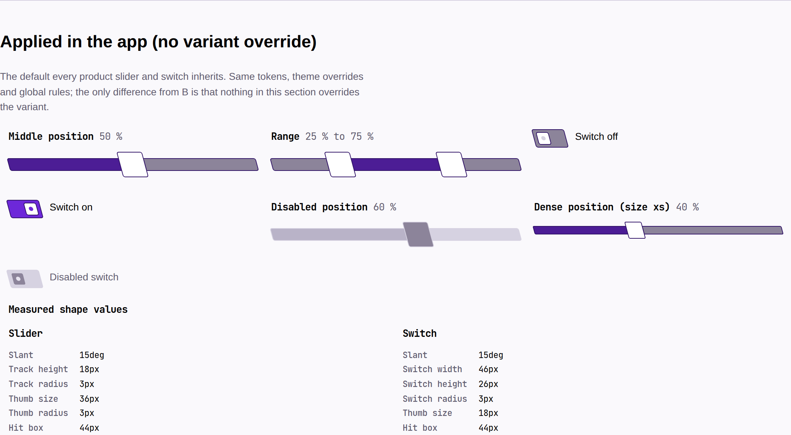
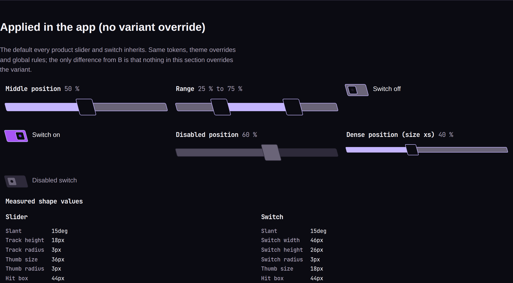

The applied section carries `.touch-targets`, so the phone shots exercise the launch-reliability
44 px switch rule: the track keeps the 26 px blade and the labelled row carries the target. Before
the selector was one class deeper (`html … .mantine-Switch-root .mantine-Switch-track`), that rule
won and the phone switch was a 44 px skewed square with a floating knob.
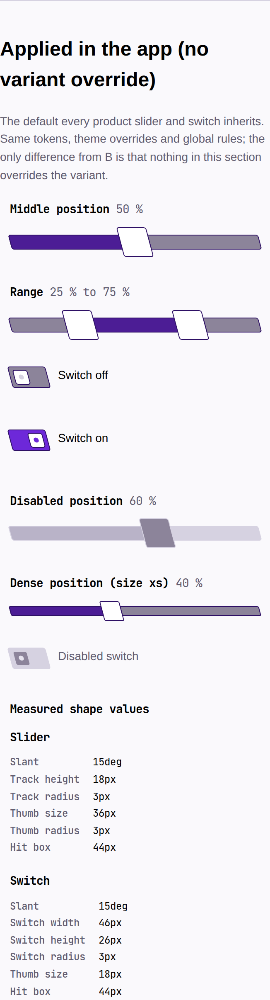
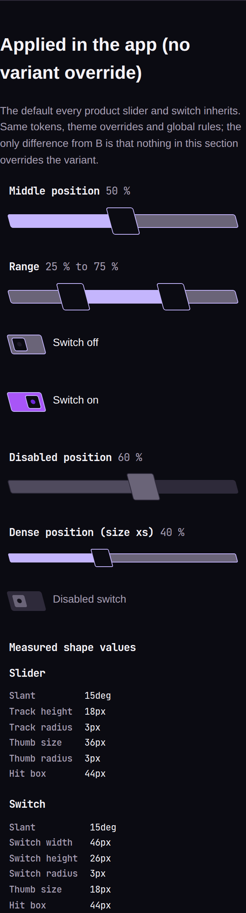
