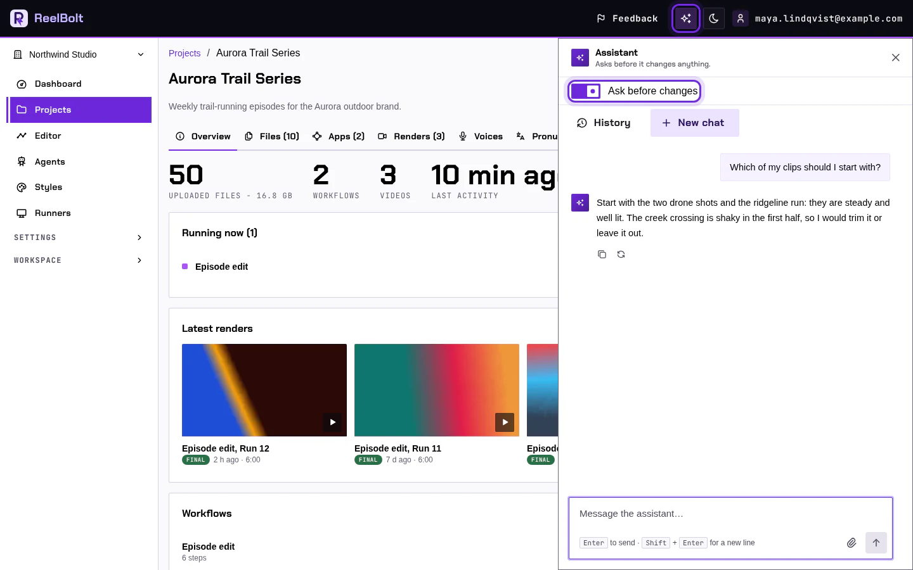
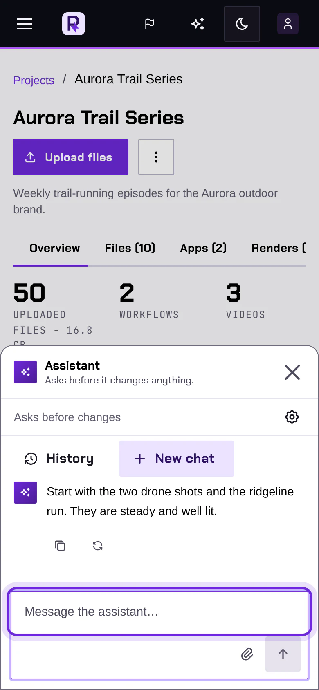
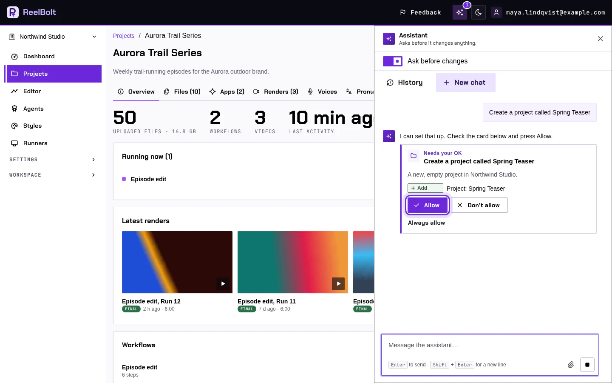

# Le basi dell'assistente {#assistant-basics}

Farai una domanda all'assistente e approverai una modifica che ti suggerisce.

## Fai una domanda {#ask-a-question}

1. Clicca il pulsante a forma di scintilla nella barra in alto. Si chiama **Assistente**. La chat si apre sulla destra.
2. Scrivi nella casella del messaggio, per esempio "Perché l'ultima esecuzione non è riuscita?" oppure "Cosa dovrei caricare?".
3. Invia il messaggio e leggi la risposta.

L'assistente sa in quale pagina ti trovi. In una pagina di progetto, "questo progetto" indica quel progetto.

Sul telefono la chat scorre su dal fondo dello schermo.

## Lascia che faccia una modifica {#let-it-make-a-change}

1. Chiedi qualcosa, per esempio "Crea un progetto chiamato Teaser di primavera".
2. Una scheda nella chat dice cosa sta per fare l'assistente.
3. Clicca **Consenti** per procedere.

Non cambia nulla finché non clicchi **Consenti**. L'interruttore **Chiedi prima di modificare** in alto nel pannello è attivo per impostazione predefinita. Lascialo attivo finché non prendi confidenza con l'assistente. Sul telefono il pannello mostra questa impostazione come **Chiede prima di modificare**.

:::tip Se qualcosa ti sembra diverso
- Diverse pagine hanno pulsanti di scorciatoia che aprono l'assistente con una domanda già pronta, come **Perché l'ultima esecuzione non è riuscita?** nella scheda **Panoramica** di un progetto.
- L'assistente usa crediti dopo la quota mensile inclusa nel tuo piano. Vedi [Quanto costa l'assistente](../account/what-the-assistant-costs.md).
:::

## Approfondisci {#go-deeper}

- [L'assistente](../assistant/index.md)
- [Quanto costa l'assistente](../account/what-the-assistant-costs.md)

Prossima guida: [Immagini e miniature](./pictures-and-thumbnails.md).
