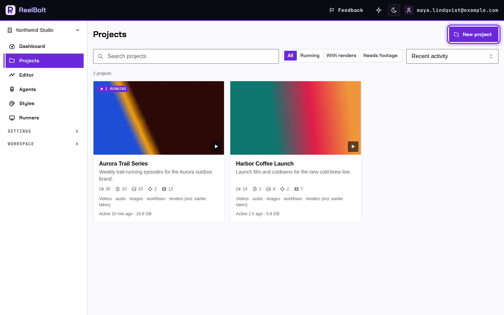
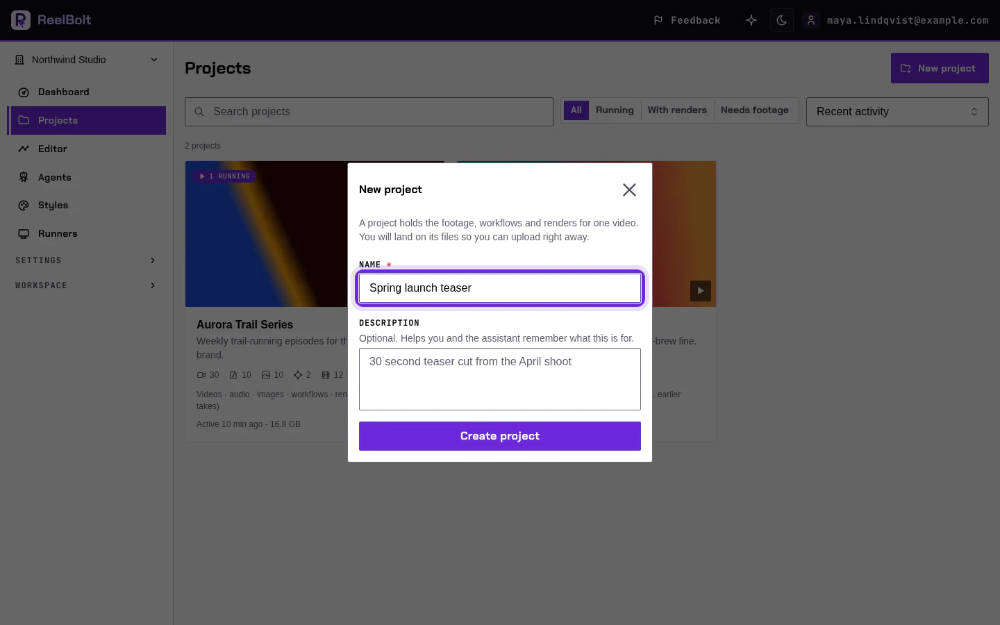
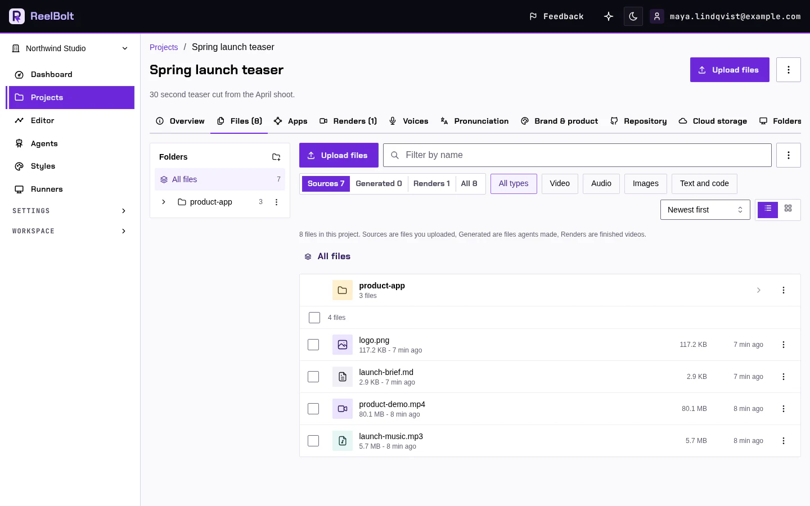

# Crea un progetto e carica i file {#create-a-project-and-upload-files}

Creerai un progetto, cioè la cartella di un video, e ci aggiungerai il tuo materiale.

## Crea il progetto {#create-the-project}

Se hai risposto alle due domande dopo la registrazione, hai già un progetto chiamato **Il mio primo video**. Aprilo da **Progetti** e vai direttamente a [Carica i tuoi file](#upload-your-files). Per creare un altro progetto:

1. Apri **Progetti** nel menu a sinistra.
2. Clicca **Nuovo progetto**.
3. Scrivi un **Nome**, per esempio "Teaser lancio di primavera". La **Descrizione** è facoltativa.
4. Sotto **Da cosa parte questo video?**, scegli **Clip che ho già girato** oppure **Un'app o un sito che ho creato**. Da qui dipende la prima app del progetto. Puoi aggiungere altre app dopo.
5. Clicca **Crea progetto**.

Il nuovo progetto si apre sulla scheda **File**.

## Carica i tuoi file {#upload-your-files}

1. Clicca **Carica file** in alto nella pagina del progetto (oppure usa **Carica** nella scheda **File**).
2. Scegli dei file, oppure scegli una cartella. Una cartella mantiene la sua struttura.
3. Aspetta che i caricamenti finiscano.

Puoi anche trascinare file o cartelle ovunque nella pagina del progetto.

Controlla il caricamento. I file caricati sono elencati sotto **Sorgenti**. Clicca un file per vederne l'anteprima.

Puoi caricare il codice della tua app come `.zip`. ReelBolt lo apre in una cartella e salta `node_modules` e i risultati della build. Vedi [Dai il tuo codice a ReelBolt](../projects/give-your-code.md).

**Uno zip oltre 64 MB non viene estratto.** ReelBolt lo conserva ma non può leggerlo. Se scegli uno zip più grande, ReelBolt ti avvisa prima di caricarlo e puoi annullare o caricarlo comunque. Invia invece il tuo codice in un altro modo: [collega il tuo repository GitHub](../projects/github-repository.md), crea uno zip più piccolo senza risultati della build, dipendenze e contenuti multimediali, oppure carica direttamente le cartelle e i file principali.

Quali file caricare dipende dal video. Per un montaggio, carica le tue clip e l'eventuale musica. Più inquadrature diverse danno un montaggio migliore di un'unica ripresa lunga. Per un promo di un'app o di un sito che hai creato, carica il suo codice sorgente.

**Analizza i video quando vengono caricati.** Se carichi video da montare, puoi chiedere a ReelBolt di esaminare ogni nuovo video in background appena viene caricato. Trova le scene, le pause e i momenti in cui succede qualcosa, così i flussi di lavoro che ne hanno bisogno partono più in fretta. Apri il menu in alto nella pagina del progetto, scegli **Modifica nome e descrizione**, attiva **Analizza i video quando vengono caricati** e salva. È disattivata per impostazione predefinita, vale per i video che carichi da quel momento in poi e non usa crediti. I risultati sono gli stessi con l'opzione attiva o no: cambia solo l'attesa.

:::tip Se qualcosa ti sembra diverso
- Il nome di un file viene rifiutato? Un nome non può essere vuoto, contenere `/` o `\`, né coincidere con un altro file nella stessa cartella. ReelBolt ti dice quale problema c'è.
- Non sai cosa caricare? Apri l'assistente e usa **Cosa dovrei caricare?** in una scheda **File** vuota.
:::

## Approfondisci {#go-deeper}

- [Caricare i file](../getting-started.md#uploading-files-to-a-reelbolt-project)
- [Dai il tuo codice a ReelBolt](../projects/give-your-code.md)
- [Sincronizzare i file da GitHub](../projects/github-repository.md)
- [Concetti](../concepts.md)

Prossima guida: [Scegli un'app e avviala](./pick-an-app-and-run.md).
