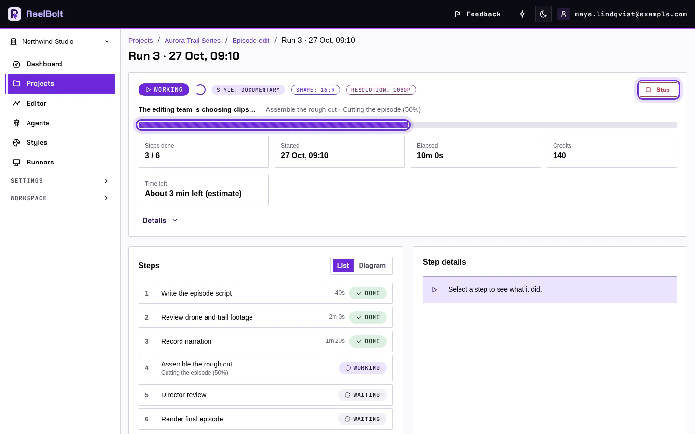
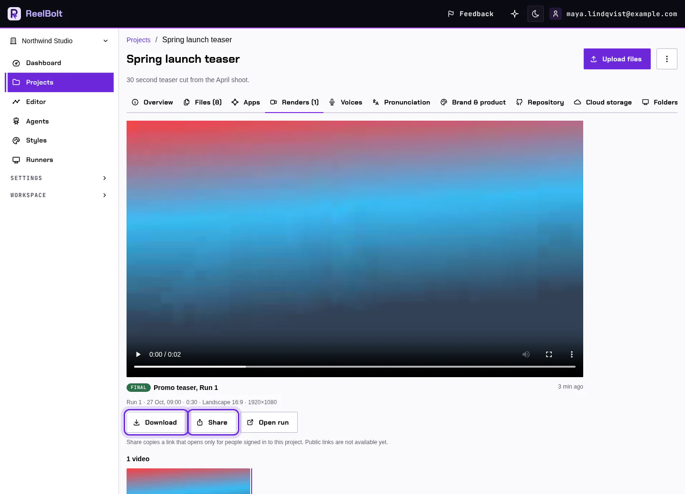

# Segui l'avanzamento, poi scarica o condividi {#follow-progress-then-download-or-share}

Guarderai la tua esecuzione, poi otterrai il video finito.

## Guarda l'esecuzione {#watch-the-run}

1. Dopo aver avviato un'esecuzione, ReelBolt apre la sua pagina.
2. Controlla il badge di stato. Dice **In attesa di iniziare**, **In lavorazione**, **Completata**, **Non riuscita** oppure **Interrotta**.
3. Leggi la riga sopra la barra di avanzamento. Dice con parole semplici cosa sta succedendo ora, per esempio "Scrittura della voce narrante".
4. Apri **Attività** per vedere cosa è successo finora, dal più recente.

Un'esecuzione può durare da pochi minuti a molto di più. Puoi lasciare la pagina. L'esecuzione prosegue e la dashboard la mostra tra le esecuzioni in corso. Per annullarla, clicca **Ferma**.

## Ottieni il video {#get-the-video}

1. Quando lo stato è **Completata**, apri il tuo progetto e vai alla scheda **Video**.
2. Clicca il video più recente contrassegnato **Finale** per riprodurlo.
3. Clicca **Scarica** per salvare il file.
4. Clicca **Condividi** per copiare un link o aprire il menu di condivisione del tuo dispositivo.

Un nuovo video può mostrare per un momento **Controllo del video**. Compare da solo quando il controllo è finito, quindi non devi ricaricare la pagina.

Un riquadro giallo in alto nella pagina dell'esecuzione o sotto il player significa che qualcosa non è venuto come richiesto. Leggilo prima di condividere il video.

## Il tuo primo video finito {#your-first-finished-video}

La prima volta che uno dei tuoi video è finito, la pagina dell'esecuzione mostra **Il tuo primo video è pronto** insieme al video. Compare una sola volta.

- **Prima** e **Dopo** riportano i dati di questa esecuzione, quando sono noti: quante clip le hai dato e quanto duravano, quanto dura il video finito e da quante parti delle tue riprese è stato montato. Sono i numeri reali della tua esecuzione. Niente è stimato, e un dato che non è noto non viene mostrato.
- **Scarica** salva il video.
- **Cambia qualcosa** ti porta dove chiedi una modifica, così sistemi una battuta o una clip senza ricominciare da capo.
- Il terzo pulsante propone un passo successivo adatto al tuo video, per esempio **Aggiungi i sottotitoli o prova un altro formato**. Aggiungere i sottotitoli apre l'app dei sottotitoli per una clip che scegli. Un altro formato riporta le scelte di questa esecuzione, così scegli un formato e premi di nuovo **Avvia**: è una nuova esecuzione.

Clicca **Chiudi** per tornare alla normale pagina del risultato.

Se la tua prima esecuzione non arriva alla fine, la pagina spiega con parole semplici cosa è successo. Se il lavoro non è riuscito per un problema nostro, i crediti trattenuti per quel lavoro vengono rimborsati. I tuoi file e le tue scelte sono ancora lì, quindi puoi avviarla di nuovo.

:::tip Se qualcosa ti sembra diverso
- Il link di condivisione si apre solo per chi ha effettuato l'accesso al tuo progetto, quindi non va bene da mandare a un cliente. Per quello usa **Scarica**.
- L'esecuzione risulta **Non riuscita**? Apri l'assistente e chiedi "Perché l'ultima esecuzione non è riuscita?", oppure leggi [Risoluzione dei problemi](../troubleshooting.md).
:::

## Approfondisci {#go-deeper}

- [Avviare i flussi di lavoro e trovare i risultati](../workflows/execution-and-outputs.md)
- [Per iniziare](../getting-started.md#watching-a-reelbolt-workflow-run)
- [Risoluzione dei problemi](../troubleshooting.md)

Prossima guida: [Chiedi modifiche](./ask-for-changes.md).
