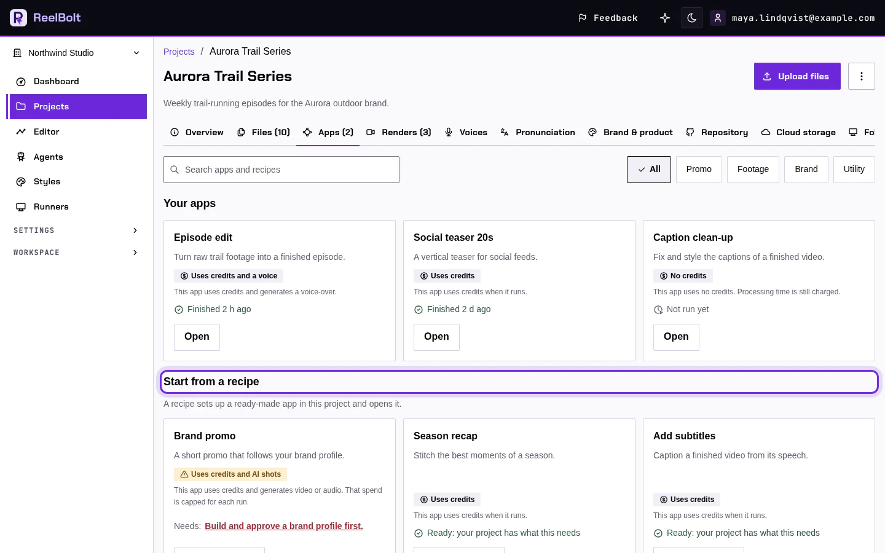
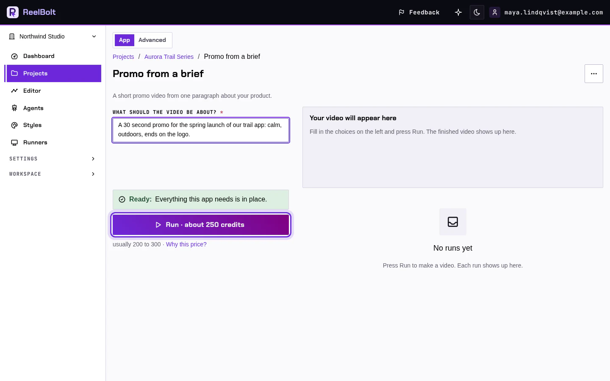

# Scegli un'app e avviala {#pick-an-app-and-run-it}

Sceglierai un'app già pronta per il tuo progetto e la avvierai. L'app crea il video.

## Scegli un'app {#choose-an-app}

1. Apri il tuo progetto e vai alla scheda **App**.
2. Sotto **Cosa vuoi fare?** ("What do you want to make?"), scegli l'app che corrisponde a ciò che vuoi creare. L'app viene aggiunta al tuo progetto e si apre.
3. Se ne hai già preparata una, la trovi sotto **Le tue app**. Clicca **Apri**.

Il tuo progetto ha già un'app da cui partire. Quale dipende da cosa hai detto che è il materiale del video: **Montaggio dei momenti migliori dal girato** per le clip che hai girato, oppure **Video promo dal tuo codice** per un'app o un sito che hai creato. La trovi sotto **Le tue app**.

## Controlla e avvia {#check-and-run}

1. Leggi cosa chiede l'app. Compila le caselle che vedi, per esempio di cosa parla il video, quanto deve durare e il formato. Bastano una o due frasi su chi deve vedere il video e cosa deve mostrare. Se non sai cosa scrivere, clicca uno degli **Esempi che puoi modificare** sotto la casella e adattalo.
2. Cerca la riga verde **Pronto**, che dice che tutto ciò che serve all'app è a posto. Se una riga dice che manca qualcosa, sistema prima quello, per esempio caricando un file.
3. Controlla il prezzo sul pulsante **Avvia**. È il numero di crediti che l'esecuzione dovrebbe usare.
4. Clicca **Avvia**. Se si apre una finestra di conferma, leggila, scrivi il tuo brief se lo chiede e clicca **Avvia esecuzione**.

Dovresti vedere l'esecuzione partire e un messaggio che dice che il tuo video è in lavorazione.

:::tip Se qualcosa ti sembra diverso
- Il tuo progetto ha una scheda **Flussi di lavoro** invece di **App**? Apri lì la tua app e clicca **Avvia**. Quello che fai dopo è lo stesso.
- Vedi **Conferma la tua email prima di avviare**? Un'esecuzione parte solo dopo che il tuo indirizzo email è confermato. Apri il link nell'email che ti ha mandato ReelBolt, oppure clicca **Invia di nuovo l'email**. Nel frattempo puoi compilare tutto il resto.
- **Avvia** è grigio? La riga sotto spiega perché e come risolvere, per esempio crediti insufficienti.
- Non sai quale app scegliere? Leggi [Scegli un'app](../recipes/choose-a-recipe.md).
:::

## Le domande dell'app {#questions-the-app-asks}

Alcune app fanno domande proprie, preparate da chi ha creato l'app. Ogni casella ha un'etichetta semplice e un testo d'esempio in grigio che mostra il tipo di risposta adatta; l'esempio non viene mai inviato.

- **Caselle di testo**: per esempio cosa succede nel video o cosa dice la persona. Una casella più lunga conta i caratteri che ti restano.
- **Interruttori**: per esempio **Modalità lite (più economica)**. Il prezzo su **Avvia** cambia quando ne attivi uno, perché l'app segue un percorso diverso.
- **Scelte, durate e formati**: scegline uno. Se cambi durata o formato, il prezzo si aggiorna dopo un attimo.
- **Un modello**: alcune app ti lasciano scegliere il modello AI che un'app usa. Ogni scheda mostra il nome del modello, una breve nota e come si confronta il suo prezzo, a parole, per esempio **Il più economico** o **Circa 2× il prezzo**. **Consigliato** viene per primo ed è scelto finché non ne scegli un altro. Un modello che qui non si può usare dice perché. Su telefono le schede si aprono da un solo pulsante in fondo allo schermo.

Le impostazioni che quasi nessuno cambia stanno sotto **Altre opzioni**, che parte chiusa. Decide chi ha creato l'app cosa metterci, e la pagina ricorda se l'hai lasciata aperta.

Se una casella obbligatoria è vuota, **Avvia** lo dice e la sua correzione ti porta a quella casella. Se un'esecuzione viene rifiutata per una risposta, il motivo compare sotto quella casella, e **Altre opzioni** si apre se la casella è lì dentro.

## Approfondisci {#go-deeper}

- [Scegli un'app](../recipes/choose-a-recipe.md)
- [Leggere la stima](../account/reading-the-estimate.md)
- [Impostazioni di esecuzione](../recipes/run-settings.md)

Prossima guida: [Segui l'avanzamento, poi scarica o condividi](./follow-progress-and-share.md).
