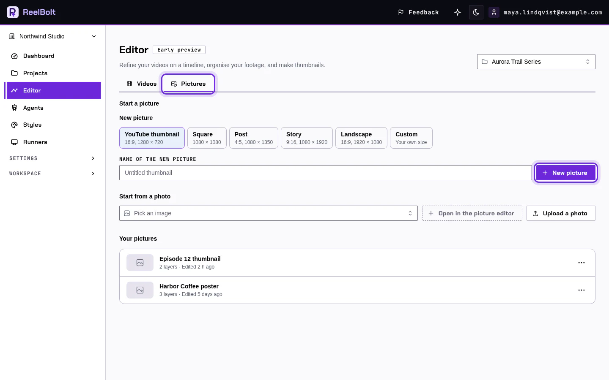
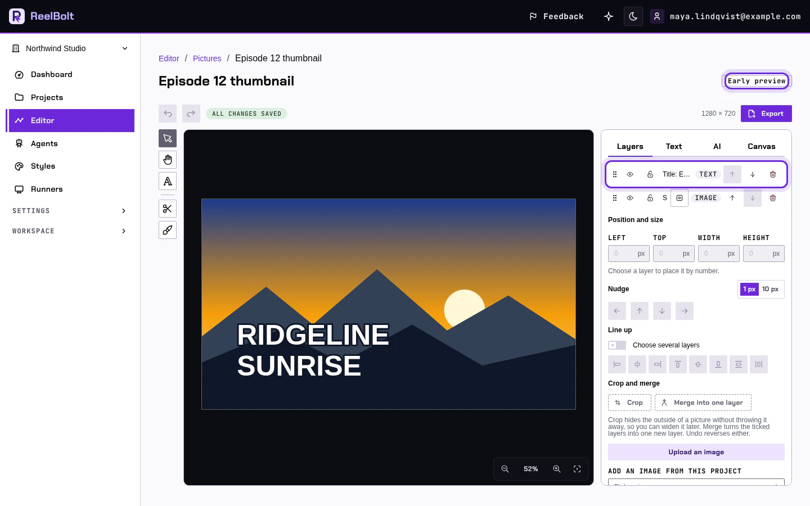

# Immagini e miniature {#pictures-and-thumbnails}

Avvierai un'immagine nell'editor di immagini e la esporterai. L'immagine originale non viene mai modificata. Ogni modifica è un livello sopra.

:::note Anteprima anticipata
L'editor di immagini fa parte dell'**anteprima anticipata** dell'editor. Il tuo lavoro viene salvato, ma alcuni strumenti potrebbero cambiare.
:::

## Avvia un'immagine {#start-a-picture}

1. Clicca **Editor** nel menu a sinistra e scegli la scheda **Immagini**.
2. Scegli una forma sotto **Nuova immagine**, per esempio Orizzontale 16:9. Dalle un nome e clicca **Nuova immagine**.
3. Per partire invece da una foto, scegli una delle tue immagini e clicca **Apri nell'editor di immagini**, oppure clicca **Carica una foto**.

## Aggiungi testo ed esporta {#add-text-and-export}

1. Nell'editor, aggiungi un livello di testo e scrivi il tuo titolo.
2. Spostalo e ridimensionalo sul canvas.
3. Apri le opzioni di esportazione e scegli un formato, come PNG o JPEG.

Gli strumenti AI, come il ritaglio di un soggetto, costano crediti ogni volta che ne usi uno. Il prezzo appare prima di avviarlo.

:::tip Se qualcosa ti sembra diverso
- I nomi di strumenti e pulsanti possono cambiare mentre l'editor è in anteprima anticipata. La [guida completa](../editor/thumbnails.md) mostra quelli attuali.
- Sul telefono l'editor ha un suo layout. Vedi la sezione "Sul telefono" della guida completa.
:::

## Approfondisci {#go-deeper}

- [Crea una miniatura](../editor/thumbnails.md)
- [Piani e crediti](../account/plans-and-credits.md)

Prossima guida: [Piano, crediti e fatturazione](./plan-credits-and-billing.md).
