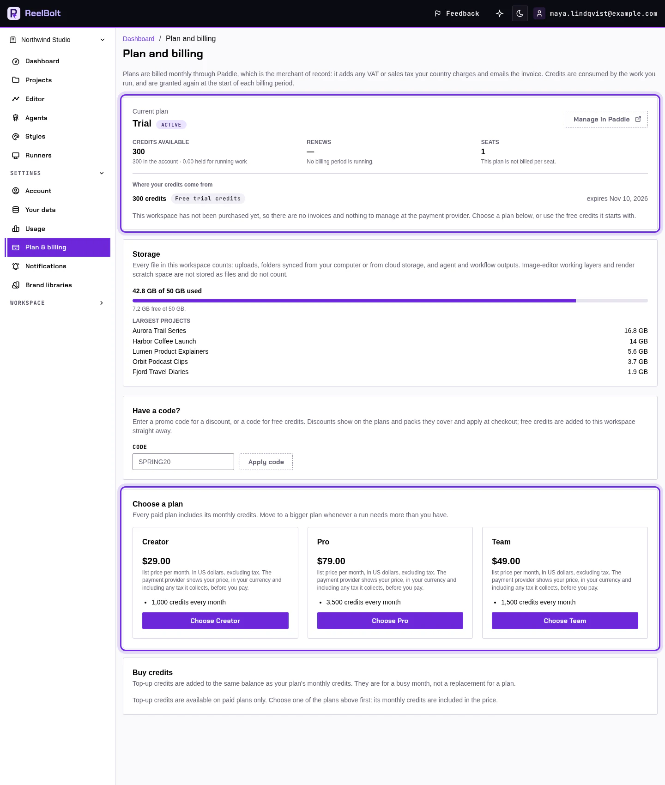
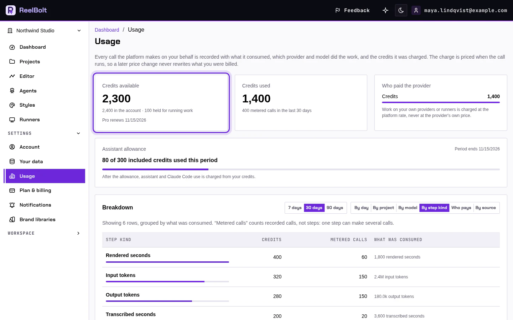

# Piano, crediti e fatturazione {#plan-credits-and-billing}

Troverai il tuo piano e i tuoi crediti e vedrai quanto costa il lavoro.

## Guarda il tuo piano e i tuoi crediti {#see-your-plan-and-credits}

1. Apri **Impostazioni** nel menu a sinistra e scegli **Piano e fatturazione**.
2. Leggi **Piano attuale** per vedere a quale piano è il tuo spazio di lavoro.
3. Apri **Utilizzo** nella stessa sezione per vedere il saldo e quanto hai usato.

Un credito è un'unità di spesa. Usano crediti i video, le risposte dell'assistente oltre la quota mensile inclusa e gli strumenti AI per le immagini. Prima di avviare un'esecuzione, i crediti previsti compaiono sul pulsante **Avvia**.

## Cambia il tuo piano {#change-your-plan}

Solo il Proprietario dello spazio di lavoro e i membri con il ruolo Fatturazione possono acquistare o cambiare un piano. Tutti gli altri vedono la pagina in sola lettura.

1. In **Piano e fatturazione**, clicca **Scegli** su un piano sotto **Scegli un piano**.
2. Completa il pagamento con il fornitore di pagamenti. I crediti vengono aggiunti dopo che il fornitore conferma il tuo pagamento.

:::tip Se qualcosa ti sembra diverso
- Mancano dei pulsanti? Puoi vedere la pagina ma non modificarla. Chiedi al Proprietario dello spazio di lavoro.
- I crediti non sono ancora stati aggiunti? Aspetta qualche minuto che il pagamento venga confermato, poi ricarica la pagina.
:::

## Approfondisci {#go-deeper}

- [Piani e crediti](../account/plans-and-credits.md)
- [Gestire il tuo piano](../account/managing-your-plan.md)
- [Leggere la stima](../account/reading-the-estimate.md)

Prossima guida: [Collega un runner](./connect-a-runner.md).
