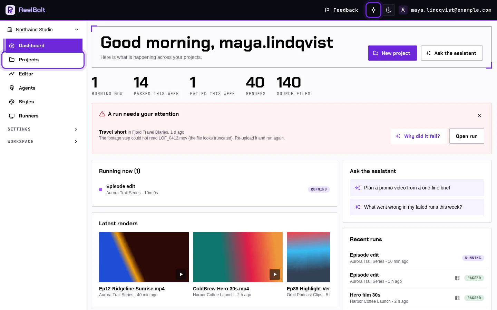
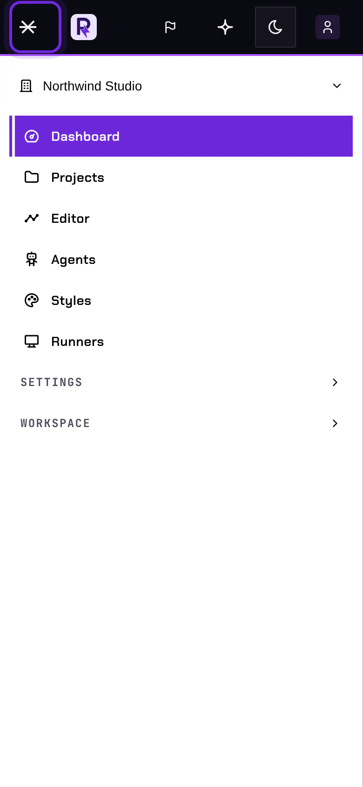

# Registrati e dai uno sguardo in giro {#sign-up-and-take-a-first-look}

Creerai il tuo account, risponderai a due domande veloci che preparano il tuo primo progetto e troverai i posti principali di ReelBolt.

## Crea il tuo account e accedi {#create-your-account-and-sign-in}

Il modo più veloce è usare un account che hai già.

1. Apri la pagina di registrazione.
2. Clicca **Continua con Google** o **Continua con GitHub** e approva la richiesta. Ti viene chiesto una sola volta di accettare i Termini di servizio e l'Informativa sulla privacy, poi sei dentro. Non devi scegliere una password né confermare un'email.

Per registrarti invece con il tuo indirizzo email:

1. Sotto **oppure registrati con l'email**, inserisci il tuo **Nome**, la tua **Email** e una **Password** di almeno 10 caratteri. La password la scrivi una volta sola. Clicca l'occhio nella casella della password per controllare cosa hai scritto.
2. Spunta la casella per accettare i Termini di servizio e l'Informativa sulla privacy. La casella delle novità sul prodotto, sotto, è facoltativa.
3. Clicca **Crea account**. Dovresti vedere **Controlla la tua email**.
4. Apri il link di conferma nell'email che ti manda ReelBolt. Il link ti fa accedere. Funziona una sola volta e dura 24 ore.

Iniziare è gratis e non serve la carta di credito.

Finché non confermi l'email, in alto resta una barra gialla **Conferma il tuo indirizzo email** e le esecuzioni non partono. Nel frattempo puoi comunque preparare tutto. Se il messaggio non è arrivato, usa **Invia di nuovo l'email** su quella barra.

:::tip Se qualcosa ti sembra diverso
- Non c'è il pulsante di Google o di GitHub? Il tuo ReelBolt non offre quel modo di accedere. Usa il tuo indirizzo email.
- Sei nel browser integrato di un'altra app, per esempio un'app social? Lì l'accesso con Google non funziona. Apri la pagina nel tuo browser abituale, oppure usa il tuo indirizzo email.
- Non c'è nessuna pagina di registrazione? Il tuo ReelBolt potrebbe essere gestito da un amministratore che crea gli account. Chiedigli la tua email e una password temporanea, accedi, poi scegli una nuova password quando ti viene chiesto.
- Nessuna email? Controlla la cartella dello spam, poi usa **Invia di nuovo l'email** nella schermata **Controlla la tua email**.
:::

## Rispondi a due domande {#answer-two-questions}

La prima volta che arrivi, ReelBolt ti fa due domande. Per ognuna basta un clic, e le tue risposte preparano il tuo primo progetto.

1. **Per cosa vuoi fare un video?** Scegli la scheda che ti somiglia di più, per esempio **Il mio canale o i miei follower**, **La mia attività** o **Le mie lezioni o il mio corso**, poi clicca **Continua**. La risposta serve solo a scegliere gli esempi e i suggerimenti che vedi. Poi puoi fare qualsiasi tipo di video.
2. **Da cosa parti?** Scegli una risposta:
   - **Clip che ho già girato**: ReelBolt crea un progetto chiamato **Il mio primo video** e lo apre dove aggiungi le tue clip.
   - **Un'app o un sito che ho creato**: il progetto si apre dove aggiungi il tuo codice.
   - **Per ora solo un'idea**: ricevi un elenco di cinque brevi clip da girare con lo smartphone. Clicca **Ho le mie clip. Aggiungile** quando sei pronto, oppure **Prima le giro** per tornare più tardi. In entrambi i casi il tuo progetto è salvato.

Ora dovresti essere nel tuo primo progetto, pronto ad aggiungere il tuo materiale.

:::tip Se qualcosa ti sembra diverso
- Vedi **Non hai clip a portata di mano? Prova con le nostre clip di esempio**? Cliccalo per provare ReelBolt con clip fornite da noi. Serve un'email confermata, e solo alcune installazioni lo offrono.
- Non vuoi rispondere adesso? Clicca **Salta per ora**. Non viene preparato nulla, e la dashboard mostra **Inizia il tuo primo video** quando vuoi tornare alle domande. Al loro posto può partire un breve tour dell'app; clicca **Salta il tour** per chiuderlo.
- Non ti è stato chiesto nulla? Le domande compaiono una sola volta, per un account nuovo in uno spazio di lavoro che non ha ancora progetti. Se sei entrato in un team che ha già dei progetti, vai direttamente alla dashboard.
:::

## Il tuo primo video, in tre attività {#your-first-video-in-three-steps}

Finché non avvii la tua prima esecuzione, la dashboard mostra un riquadro **Il tuo primo video** con tre attività. Ogni attività è un link al posto in cui lo fai, e il riquadro indica qual è il prossimo.

1. **Aggiungi le tue clip** (oppure **Aggiungi il tuo codice**). Carica quello che hai già girato. Più inquadrature diverse danno un montaggio migliore di un'unica ripresa lunga.
2. **Di' a cosa serve.** Una o due frasi: per chi è il video e cosa deve mostrare. Il riquadro ti dà un esempio da cui partire.
3. **Premi Avvia.** Ottieni un primo montaggio su cui dire la tua. Un lavoro piccolo richiede pochi minuti, uno grande a volte mezz'ora. Puoi lasciare la pagina mentre lavora.

Se hai scelto **Per ora solo un'idea**, nel riquadro trovi anche **Vedi il tuo elenco di riprese**.

Le prossime tre guide seguono questi passaggi: [Crea un progetto e carica i file](./create-a-project-and-upload.md), [Scegli un'app e avviala](./pick-an-app-and-run.md) e [Segui l'avanzamento, poi scarica o condividi](./follow-progress-and-share.md).

## Orientati {#find-your-way-around}

Il menu a sinistra contiene i posti che usi ogni giorno:

- **Dashboard**: attività recenti ed esecuzioni in corso.
- **Progetti**: un progetto per ogni video che crei.
- **Editor**: apri un video come timeline, oppure lavora su un'immagine (anteprima anticipata).
- **Agenti**, **Stili** e **Runner**: i collaboratori AI, gli stili di montaggio e gli eventuali computer che hai collegato.

Il pulsante a forma di scintilla nella barra in alto apre l'**assistente**. **Impostazioni**, in fondo al menu, contiene il tuo account, il tuo utilizzo e il tuo piano.

Sul telefono il menu sta dietro al pulsante del menu nella barra in alto. Toccalo, scegli un posto e il menu si chiude.

Nella dashboard c'è anche un elenco **Per iniziare** che si spunta da solo man mano che procedi: crea un progetto, carica un file, avvia il tuo primo video, apri il risultato, prova l'assistente, apri l'editor. Puoi chiuderlo quando vuoi. Per un breve giro guidato del menu, dell'assistente e di dove arrivano i tuoi video, apri **Aiuto** nella barra in alto e clicca **Fai il tour**.

:::tip Se qualcosa ti sembra diverso
Alcune voci compaiono solo per alcune persone. **Spazio di lavoro** compare per i proprietari e gli amministratori dello spazio di lavoro, e **Piattaforma** solo per gli amministratori dell'intera installazione.
:::

## Approfondisci {#go-deeper}

- [Per iniziare](../getting-started.md)
- [Spazi di lavoro e team](../workspaces.md)
- [Concetti](../concepts.md)

Prossima guida: [Crea un progetto e carica i file](./create-a-project-and-upload.md).
