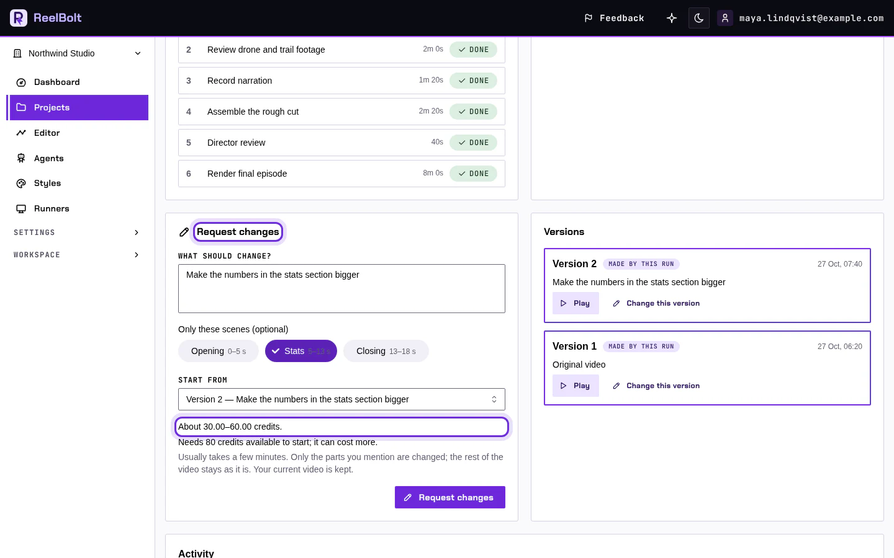

# Chiedi modifiche {#ask-for-changes}

Chiederai una modifica a un video finito. Cambiano solo le parti che indichi e il tuo video attuale resta com'è.

## Richiedi una modifica {#request-a-change}

1. Apri la pagina dell'esecuzione finita.
2. Trova **Richiedi modifiche** e scrivi cosa deve cambiare. Sii preciso su cosa e dove. "Ingrandisci i numeri nella sezione delle statistiche" funziona meglio di "rendilo migliore".
3. Facoltativo: sotto **Solo queste scene**, scegli le scene a cui si riferisce la modifica.
4. Facoltativo: sotto **Parti da**, scegli una versione precedente.
5. Controlla i crediti mostrati nel pannello, poi clicca **Richiedi modifiche**.

Dovresti vedere aprirsi una nuova esecuzione. Seguila come prima. Quando finisce, la nuova versione compare nella scheda **Render** accanto alla vecchia.

:::tip Se qualcosa ti sembra diverso
- Non c'è il pannello **Richiedi modifiche**? Compare solo sulle esecuzioni finite dei video animati. Per gli altri video, avvia di nuovo l'app con un nuovo brief, oppure usa l'[editor](./editor-basics.md).
- Una parte della tua animazione sta dentro un montaggio più lungo? Il pannello elenca i passaggi successivi che vengono rieseguiti e ti lascia scegliere cosa fare del montaggio.
:::

Devi cambiare più cose insieme, come la voce narrante e le grafiche? Aggiungi ogni modifica a un elenco e inviale tutte insieme; vedi [Cambiare più cose insieme](../workflows/request-changes.md#changing-several-things-at-once).

## Approfondisci {#go-deeper}

- [Richiedere modifiche a un video finito](../workflows/request-changes.md)
- [Quanto costa l'assistente](../account/what-the-assistant-costs.md)

Prossima guida: [Le basi dell'editor](./editor-basics.md).
