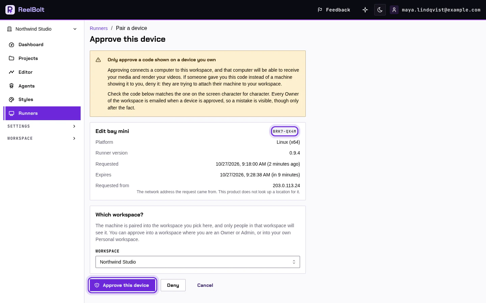
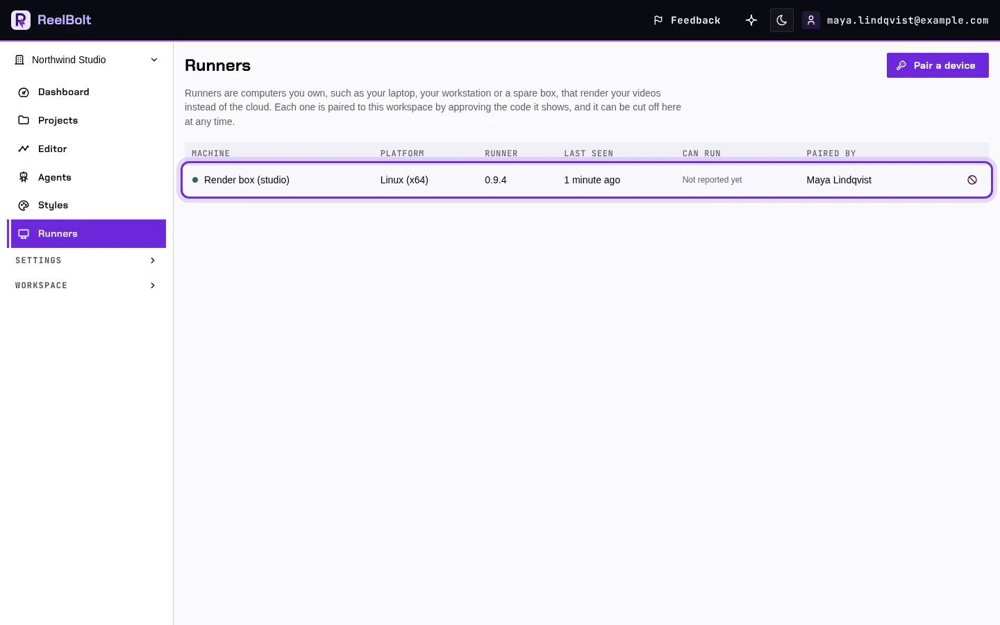

# Collega un runner {#connect-a-runner}

Questa guida è facoltativa. Collegherai un computer tuo perché faccia il lavoro pesante sui video al posto del cloud.

## Collega il tuo computer {#pair-your-computer}

1. Installa il Runner di ReelBolt sul tuo computer Windows o Linux. Le [pagine di installazione](../runner/index.md) spiegano come.
2. Avvia il Runner. Mostra un codice breve e apre una pagina di ReelBolt nel browser.
3. Nella pagina **Approva questo dispositivo**, controlla che il codice coincida con quello sul tuo computer.
4. Scegli lo spazio di lavoro in cui collegare il computer.
5. Clicca **Approva questo dispositivo**.

Ora il computer compare sotto **Runner** nel menu a sinistra.

Il lavoro svolto sul tuo computer non usa crediti ReelBolt. Il ragionamento dell'AI, la fatturazione e l'archiviazione restano su ReelBolt.

:::tip Se qualcosa ti sembra diverso
- Il codice è scaduto? Chiedi al Runner un codice nuovo.
- Non riesci a scegliere lo spazio di lavoro? Devi esserne Proprietario o Amministratore.
:::

## Approfondisci {#go-deeper}

- [Runner di ReelBolt](../runner/index.md)
- [Collega il Runner](../runner/pairing.md)
- [Runner desktop](../account/desktop-runner.md)
