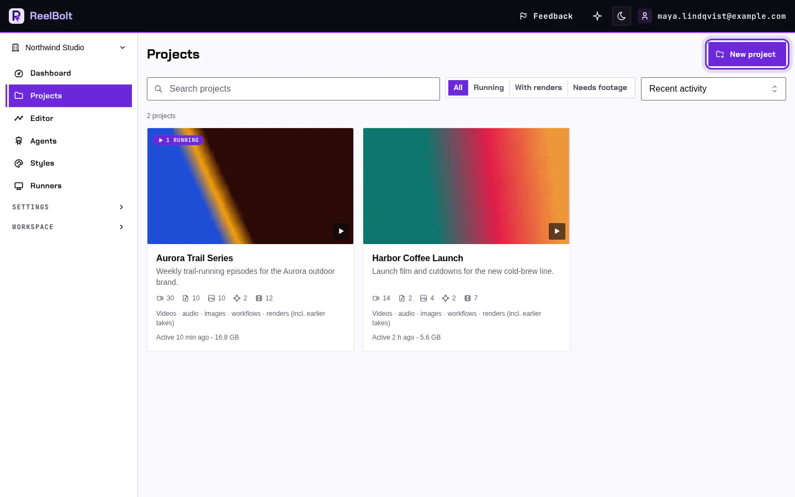
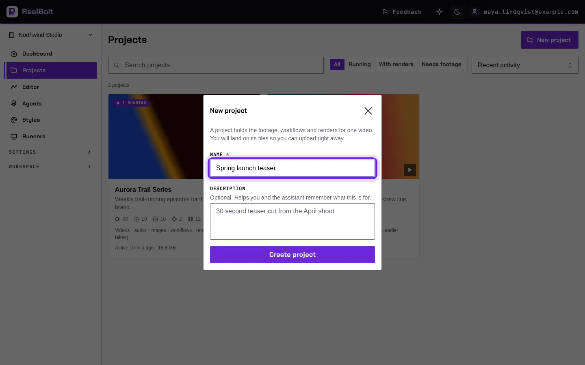
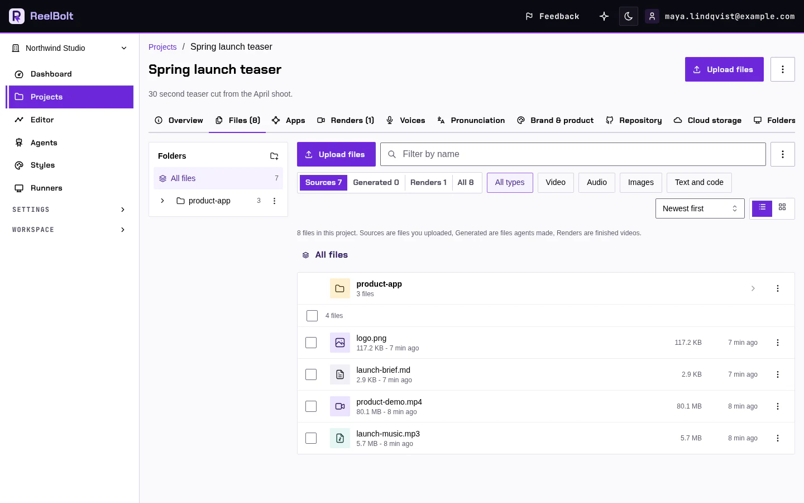

# Crea un progetto e carica i file {#create-a-project-and-upload-files}

Creerai un progetto, cioè la cartella di un video, e ci aggiungerai il tuo materiale.

## Crea il progetto {#create-the-project}

1. Apri **Progetti** nel menu a sinistra.
2. Clicca **Nuovo progetto**.
3. Scrivi un **Nome**, per esempio "Teaser lancio di primavera". La **Descrizione** è facoltativa.
4. Clicca **Crea progetto**.

Il nuovo progetto si apre sulla scheda **File**.

## Carica i tuoi file {#upload-your-files}

1. Clicca **Carica file** in alto nella pagina del progetto (oppure usa **Carica** nella scheda **File**).
2. Scegli dei file, oppure scegli una cartella. Una cartella mantiene la sua struttura.
3. Aspetta che i caricamenti finiscano.

Puoi anche trascinare file o cartelle ovunque nella pagina del progetto.

Controlla il caricamento. I file caricati sono elencati sotto **Sorgenti**. Clicca un file per vederne l'anteprima.

Quali file caricare dipende dal video. Per un promo del tuo prodotto, carica il suo codice sorgente. Per un montaggio, carica i tuoi filmati e l'eventuale musica.

:::tip Se qualcosa ti sembra diverso
- Il nome di un file viene rifiutato? Un nome non può essere vuoto, contenere `/` o `\`, né coincidere con un altro file nella stessa cartella. ReelBolt ti dice quale problema c'è.
- Non sai cosa caricare? Apri l'assistente e usa **Cosa dovrei caricare?** in una scheda **File** vuota.
:::

## Approfondisci {#go-deeper}

- [Caricare i file](../getting-started.md#uploading-files-to-a-reelbolt-project)
- [Sincronizzare i file da GitHub](../projects/github-repository.md)
- [Concetti](../concepts.md)

Prossima guida: [Scegli un'app e avviala](./pick-an-app-and-run.md).
