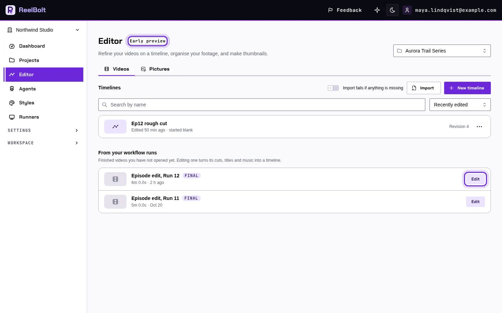
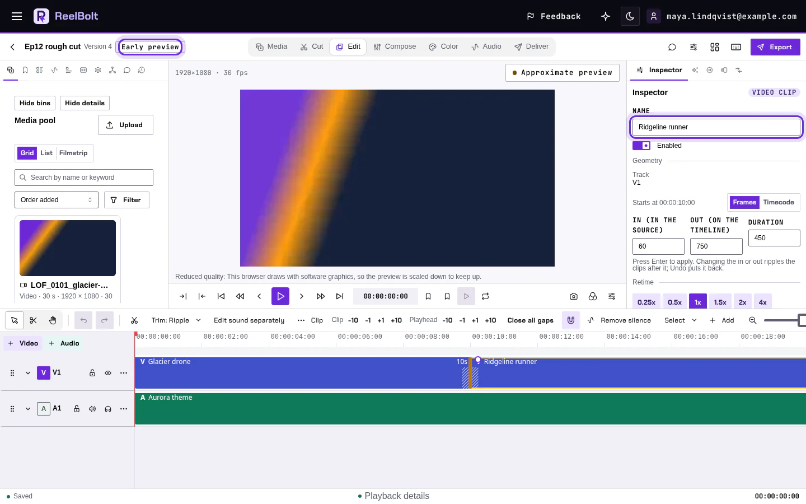

# Le basi dell'editor {#editor-basics}

Aprirai un video come timeline, cioè le tracce di clip disposte nel tempo, e lo modificherai a mano.

:::note Anteprima anticipata
L'editor è in **anteprima anticipata**. Lo stiamo ancora completando. Il tuo lavoro viene salvato, ma alcuni strumenti potrebbero cambiare. Clicca o tocca l'etichetta **Anteprima anticipata** in qualsiasi pagina dell'editor per saperne di più.
:::

## Apri una timeline {#open-a-timeline}

1. Clicca **Editor** nel menu a sinistra.
2. Scegli il tuo progetto con il selettore del progetto in alto a destra.
3. Nella scheda **Video**, trova il tuo video sotto **Dalle esecuzioni dei tuoi flussi di lavoro** e clicca **Modifica**. Oppure clicca **Nuova timeline** per partire da una vuota.

Si apre la timeline. Riaprendo lo stesso video torni alla timeline che avevi già creato.

## Riproduci e fai una piccola modifica {#play-and-make-a-small-change}

1. Premi il pulsante di riproduzione, o la barra spaziatrice, per guardare il montaggio.
2. Clicca una clip per selezionarla. Trascinala per spostarla.
3. Usa il pulsante annulla se cambi idea. Le modifiche vengono salvate man mano.

L'editor modifica il montaggio, non il file del video finito. Per ottenere un nuovo video, esportalo dalla schermata di esportazione dell'editor.

:::tip Se qualcosa ti sembra diverso
- Il tuo video non è nell'elenco? Sotto **Dalle esecuzioni dei tuoi flussi di lavoro** compaiono solo i video finiti di un'esecuzione che produce un montaggio modificabile. Usa invece **Nuova timeline**.
- Alcuni strumenti sembrano diversi su uno schermo stretto. La pagina dell'editor spiega il layout per il telefono.
:::

## Approfondisci {#go-deeper}

- [L'editor della timeline](../editor/index.md)
- [Salvataggio e ripristino](../editor/saving-and-recovering.md)
- [Esporta il tuo film](../editor/export-your-film.md)

Prossima guida: [Le basi dell'assistente](./assistant-basics.md).
