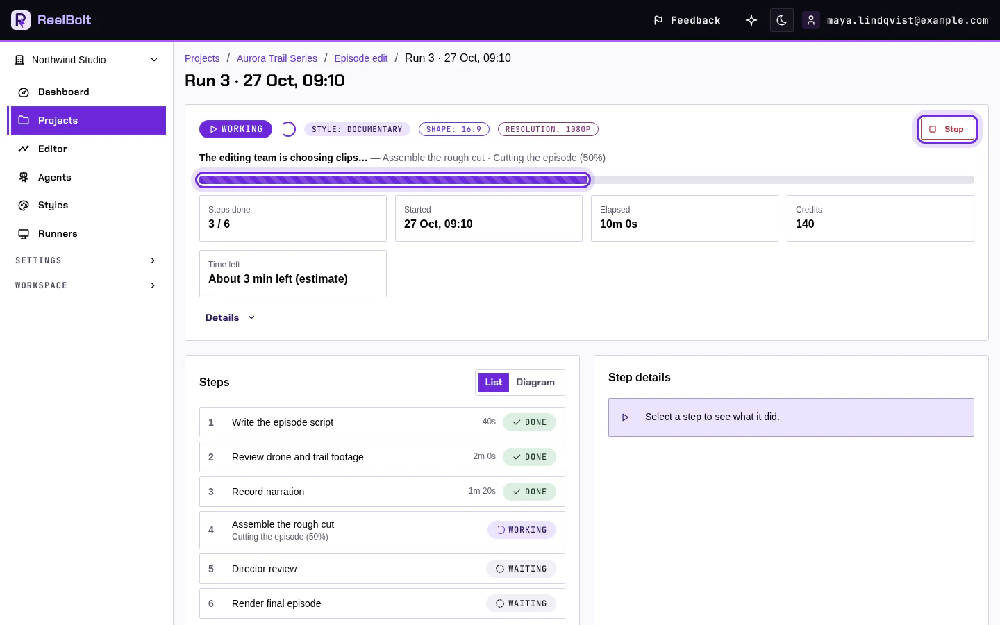
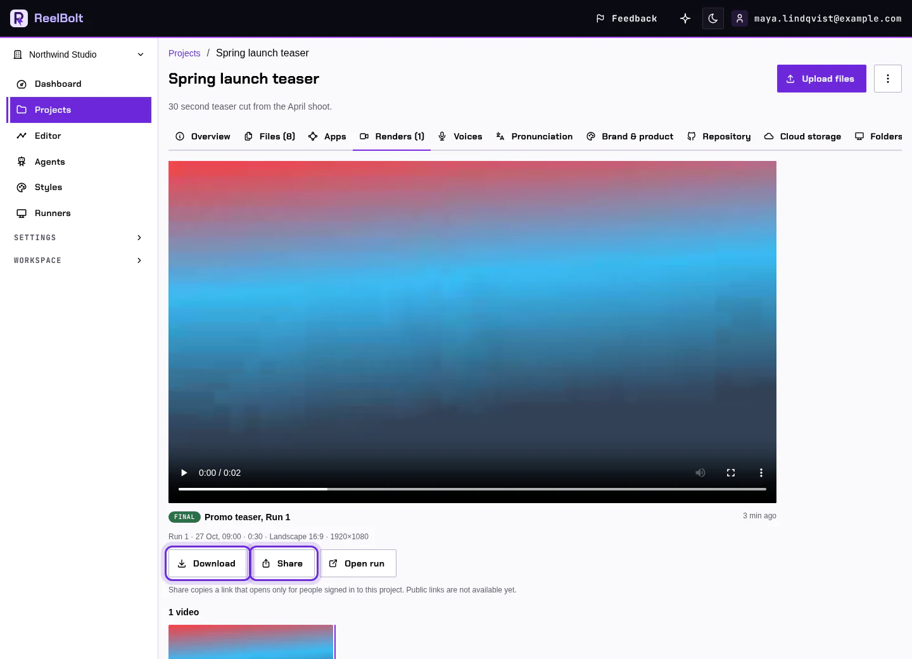

# Segui l'avanzamento, poi scarica o condividi {#follow-progress-then-download-or-share}

Guarderai la tua esecuzione, poi otterrai il video finito.

## Guarda l'esecuzione {#watch-the-run}

1. Dopo aver avviato un'esecuzione, ReelBolt apre la sua pagina.
2. Controlla il badge di stato. Dice **In attesa di iniziare**, **In lavorazione**, **Completata**, **Non riuscita** oppure **Interrotta**.
3. Leggi la riga sopra la barra di avanzamento. Dice con parole semplici cosa sta succedendo ora, per esempio "Scrittura della voce narrante".
4. Apri **Attività** per vedere cosa è successo finora, dal più recente.

Un'esecuzione può durare da pochi minuti a molto di più. Puoi lasciare la pagina. L'esecuzione prosegue e la dashboard la mostra tra le esecuzioni in corso. Per annullarla, clicca **Ferma**.

## Ottieni il video {#get-the-video}

1. Quando lo stato è **Completata**, apri il tuo progetto e vai alla scheda **Render**.
2. Clicca il render più recente contrassegnato **Finale** per riprodurlo.
3. Clicca **Scarica** per salvare il file.
4. Clicca **Condividi** per copiare un link o aprire il menu di condivisione del tuo dispositivo.

Un riquadro giallo in alto nella pagina dell'esecuzione o sotto il player significa che qualcosa non è venuto come richiesto. Leggilo prima di condividere il video.

:::tip Se qualcosa ti sembra diverso
- Il link di condivisione si apre solo per chi ha effettuato l'accesso al tuo progetto, quindi non va bene da mandare a un cliente. Per quello usa **Scarica**.
- L'esecuzione risulta **Non riuscita**? Apri l'assistente e chiedi "Perché l'ultima esecuzione non è riuscita?", oppure leggi [Risoluzione dei problemi](../troubleshooting.md).
:::

## Approfondisci {#go-deeper}

- [Avviare i flussi di lavoro e trovare i risultati](../workflows/execution-and-outputs.md)
- [Per iniziare](../getting-started.md#watching-a-reelbolt-workflow-run)
- [Risoluzione dei problemi](../troubleshooting.md)

Prossima guida: [Chiedi modifiche](./ask-for-changes.md).
