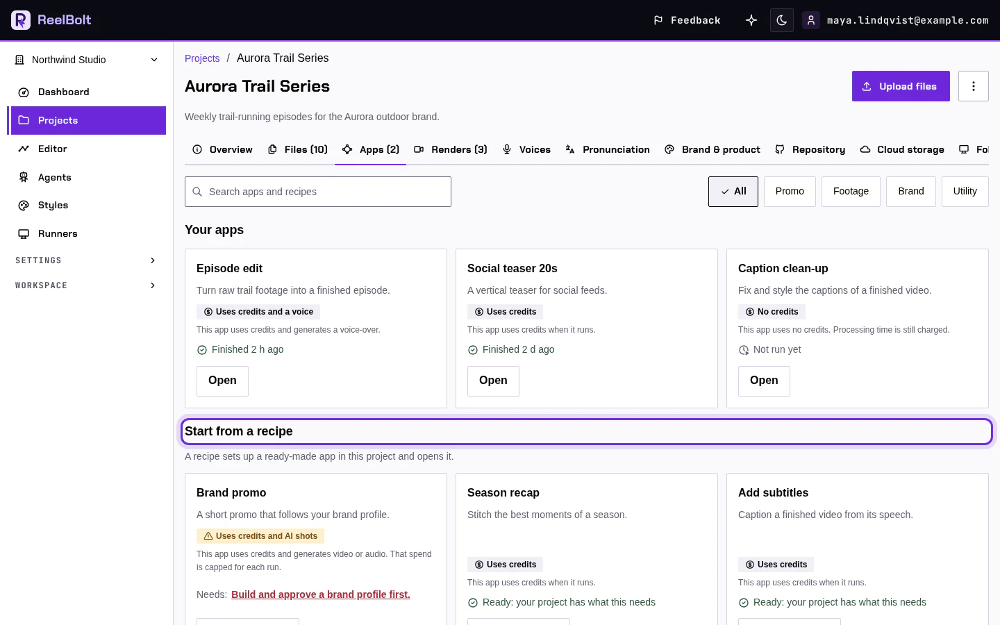
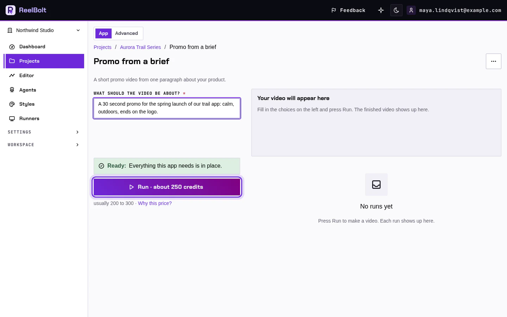

# Scegli un'app e avviala {#pick-an-app-and-run-it}

Sceglierai un'app già pronta per il tuo progetto e la avvierai. L'app crea il video.

## Scegli un'app {#choose-an-app}

1. Apri il tuo progetto e vai alla scheda **App**.
2. Sotto **Parti da una ricetta**, scegli l'app che corrisponde a ciò che vuoi creare. Una ricetta prepara nel tuo progetto un'app già pronta e la apre.
3. Se ne hai già preparata una, la trovi sotto **Le tue app**. Clicca **Apri**.

Ogni nuovo progetto ha già un'app iniziale che crea un video promozionale dal tuo codice.

## Controlla e avvia {#check-and-run}

1. Leggi cosa chiede l'app. Compila le caselle che vedi, per esempio di cosa parla il video, quanto deve durare e il formato.
2. Cerca la riga verde **Pronto**, che dice che tutto ciò che serve all'app è a posto. Se una riga dice che manca qualcosa, sistema prima quello, per esempio caricando un file.
3. Controlla il prezzo sul pulsante **Avvia**. È il numero di crediti che l'esecuzione dovrebbe usare.
4. Clicca **Avvia**. Se si apre una finestra di conferma, leggila, scrivi il tuo brief se lo chiede e clicca **Avvia esecuzione**.

Dovresti vedere l'esecuzione partire e un messaggio che dice che il tuo video è in lavorazione.

:::tip Se qualcosa ti sembra diverso
- Il tuo progetto ha una scheda **Flussi di lavoro** invece di **App**? Apri lì il tuo flusso di lavoro e clicca **Avvia**. I passaggi successivi sono gli stessi.
- **Avvia** è grigio? La riga sotto spiega perché e come risolvere, per esempio un'email non confermata o crediti insufficienti.
- Non sai quale app scegliere? Leggi [Scegli una ricetta](../recipes/choose-a-recipe.md).
:::

## Approfondisci {#go-deeper}

- [Scegli una ricetta](../recipes/choose-a-recipe.md)
- [Leggere la stima](../account/reading-the-estimate.md)
- [Impostazioni di esecuzione](../recipes/run-settings.md)

Prossima guida: [Segui l'avanzamento, poi scarica o condividi](./follow-progress-and-share.md).
