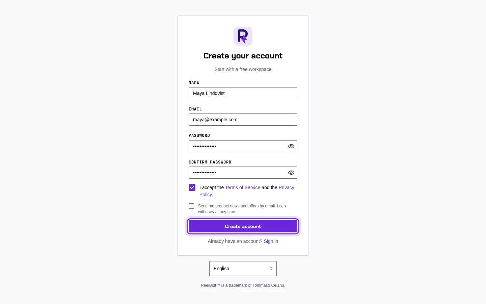
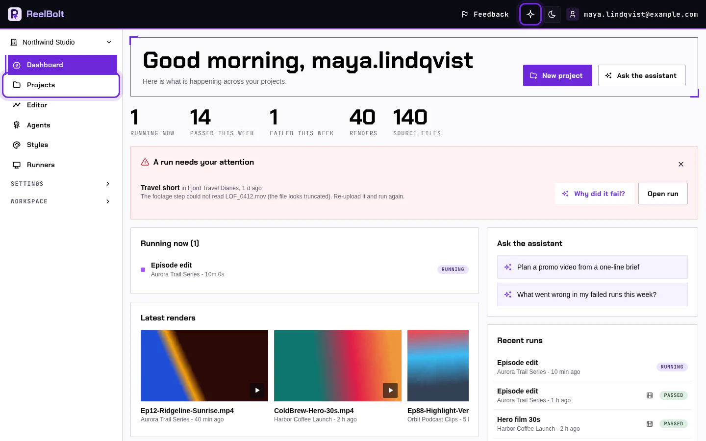
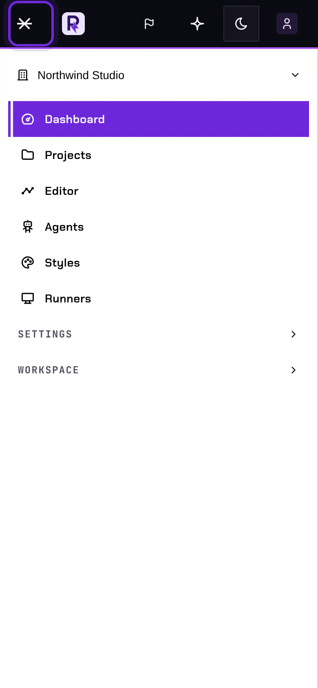

# Registrati e dai uno sguardo in giro {#sign-up-and-take-a-first-look}

Creerai il tuo account, accederai e troverai i posti principali di ReelBolt.

## Crea il tuo account e accedi {#create-your-account-and-sign-in}

1. Apri la pagina di registrazione.
2. Inserisci **Nome**, **Email** e una **Password** (di almeno 10 caratteri), poi scrivi di nuovo la password in **Conferma la password**.
3. Spunta la casella per accettare i Termini di servizio e l'Informativa sulla privacy. La casella delle novità sul prodotto, sotto, è facoltativa. Poi clicca **Crea account**.
4. Apri il link di conferma nell'email che ti manda ReelBolt.
5. Accedi con la tua email e la tua password.

Dovresti vedere la dashboard. Finché non confermi l'email, in alto resta una barra gialla **Conferma il tuo indirizzo email** e le esecuzioni che costano crediti sono disattivate. Se il messaggio non è arrivato, usa **Invia di nuovo l'email** su quella barra.

:::tip Se qualcosa ti sembra diverso
- Non c'è nessuna pagina di registrazione? Il tuo ReelBolt potrebbe essere gestito da un amministratore che crea gli account. Chiedigli la tua email e una password temporanea, accedi, poi scegli una nuova password quando ti viene chiesto.
- Nessuna email? Controlla la cartella dello spam, poi usa **Invia di nuovo l'email**.
:::

## Orientati {#find-your-way-around}

Il menu a sinistra contiene i posti che usi ogni giorno:

- **Dashboard**: attività recenti ed esecuzioni in corso.
- **Progetti**: un progetto per ogni video che crei.
- **Editor**: apri un video come timeline, oppure lavora su un'immagine (anteprima anticipata).
- **Agenti**, **Stili** e **Runner**: i collaboratori AI, gli stili di montaggio e gli eventuali computer che hai collegato.

Il pulsante a forma di scintilla nella barra in alto apre l'**assistente**. **Impostazioni**, in fondo al menu, contiene il tuo account, il tuo utilizzo e il tuo piano.

Sul telefono il menu sta dietro al pulsante del menu nella barra in alto. Toccalo, scegli un posto e il menu si chiude.

:::tip Se qualcosa ti sembra diverso
Alcune voci compaiono solo per alcune persone. **Spazio di lavoro** compare per i proprietari e gli amministratori dello spazio di lavoro, e **Piattaforma** solo per gli amministratori dell'intera installazione.
:::

## Approfondisci {#go-deeper}

- [Per iniziare](../getting-started.md)
- [Spazi di lavoro e team](../workspaces.md)
- [Concetti](../concepts.md)

Prossima guida: [Crea un progetto e carica i file](./create-a-project-and-upload.md).
